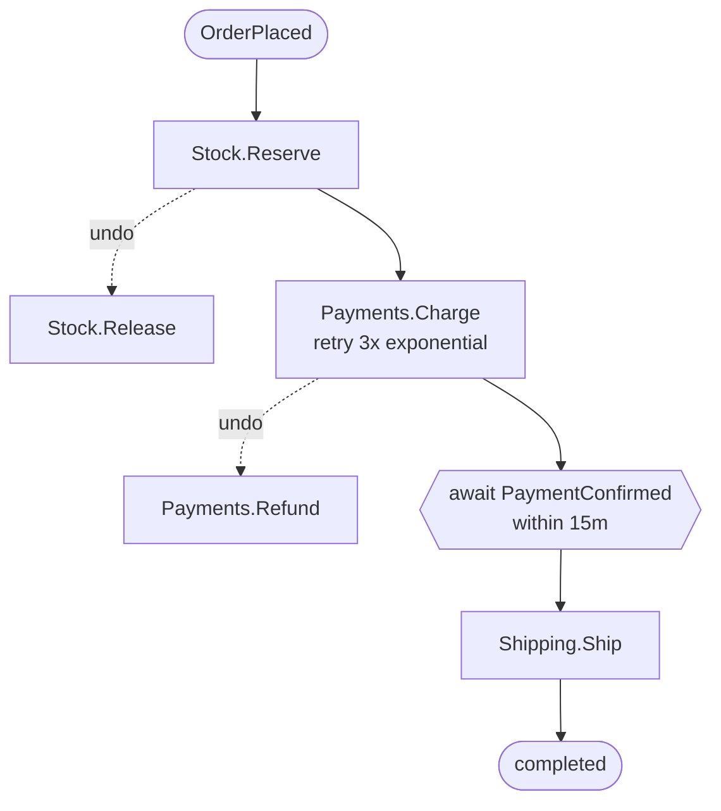

<div align="center">


**Deterministic event-driven processes for .NET.**

*Event-driven that's no longer weird.*

[Website & documentation](https://aminch18.github.io/wyrd/) · [Philosophy](docs/guides/philosophy.md) · [From DDD to Wyrd](docs/guides/from-ddd-to-wyrd.md) · [Roadmap](docs/ROADMAP.md)

</div>

Wyrd is an open-source .NET 10 / C# 14 library for event-driven processes that behave the same way every time.
You write pure business decisions and declarative sagas; Wyrd owns retries, timeouts, compensations and
idempotency, enforces versioned message contracts at compile time, and simulates hostile futures before you deploy.

> [!WARNING]
> **Preview for feedback, not for production yet.** Available today: the message and process model, the analyzers
> and contract snapshots, the in-memory runtime, `Wyrd.Testing`, the `dotnet wyrd` tool and **Skuld** (failure
> simulation). The durable runtime (PostgreSQL, transports) is in progress. Everything marked ✅ works and is
> covered by tests; 🔜 and 🚧 are designed and on the [roadmap](docs/ROADMAP.md). APIs may change before 1.0.
> Please [tell us what you think](https://github.com/aminch18/wyrd/discussions).

## Try it in two minutes

You need the [.NET 10 SDK](https://dotnet.microsoft.com/download).

```bash
git clone https://github.com/aminch18/wyrd.git && cd wyrd
dotnet run --project samples/Shop.Console   # six order scenarios with a colored journal
dotnet test samples/Shop.Tests              # business specs, including Skuld exploring thousands of futures
dotnet run --project samples/Shop.Api       # the same shop as an HTTP API on http://localhost:5080
```

Then break something on purpose: change a field type in `samples/Shop/Contracts/IntegrationEvents.cs` and
rebuild to see `WYRD0201`, or remove a `.Retry(...)` from the order process and run the Skuld specs. The
[demo script](docs/launch/demo.md) walks through both. Questions and ideas are welcome in
[Discussions](https://github.com/aminch18/wyrd/discussions); the [documentation site](https://aminch18.github.io/wyrd/)
has the mental model first and the details second.

---

Sagas, outboxes, retries and compensations are where event-driven systems quietly break: a duplicated
message charges a customer twice, a missing timeout leaves an order stuck forever, a compensation that
never runs leaves stock reserved. It all compiles. It all passes the happy-path tests.

**Make the business decision explicit. Let the framework execute its consequences.**
Wyrd brings functional domain modeling and declarative process policies to everyday C#. A command and current
state produce an accepted fact or a rejection. State evolves from accepted facts. A process describes how those
decisions connect over time, while the runtime owns the message-handling mechanics around them.

**The vision:** bring DDD to the functional paradigm in everyday C#, so that the people who understand the
business can build distributed systems — and .NET engineers become *product engineers*: domain, architecture
and code, three in one.

- **You write pure functions.** Command + state in, event or error out. No `DbContext`, no publisher, no `await`.
- **Wyrd owns the side effects.** Retries, timeouts, compensations, idempotency and (soon) the outbox are the framework's job.
- **The process is data.** Six declarative lines that a reviewer can read, and that Wyrd can run, draw, simulate and replay.
- **Commands, domain events and integration events are different things** — and the compiler knows it.
- **Integration events are versioned contracts.** Breaking a published event is a build error, not a production incident.
- **Deterministic by design.** Same inputs, same outcome, every time.

## Why this changes the way you model

DDD starts with the business: its language, its boundaries, and the rules that must always hold. Wyrd keeps
those ideas. It changes how behavior is expressed, from a method that checks and mutates an aggregate to a pure
decision against immutable state, followed by an explicit state transition.

That is a separation of responsibilities, not a removal of behavior. Your order still owns its invariants.
Its entities retain their identities. A `Money` value still owns its currency rules. Shared policies belong
close to the domain and must be used by every relevant decision; splitting commands into slices is not a
reason to duplicate rules or split a consistency boundary.

The practical difference is what a reviewer has to understand. To review whether an order may be cancelled,
read a decision and its specifications. To review what happens after a payment times out, read the process
policy. You should not need to reconstruct a business workflow from a chain of handlers and infrastructure
callbacks before you can challenge the rule.

```text
Command + current state  →  domain event or rejection
Current state + event   →  next state
Process policy         →  next command, wait, retry, or compensation
```

The domain chooses what is allowed and what failure means. The runtime supplies the execution mechanics.
Determinism makes the result reproducible; it does not prove that the business rule itself is correct.

This uses ordinary C# records, methods, and pattern matching. It does not require an event-sourced storage
model or a microservices deployment: the current host loads serialized state, and the Shop sample is a
modular monolith. Domain boundaries and deployment boundaries are separate choices.

### Start with the mental model

- [The Wyrd philosophy](docs/guides/philosophy.md): why decisions, effects, and processes have distinct responsibilities; when that separation helps.
- [From classic DDD to Wyrd](docs/guides/from-ddd-to-wyrd.md): the same order-cancellation rule in both styles, with aggregates, entities, value objects, invariants, repositories, and events mapped one by one.
- [Quick start](#quick-start): see the concrete APIs after the architectural change makes sense.
- [The Shop sample](samples/Shop) and [business specifications](samples/Shop.Tests): follow the model in working code.

Start with one meaningful behavior or bounded context. Wyrd is not a requirement to rewrite an application,
and a simple CRUD screen may not benefit from a command/event/process model. Today the runtime is in memory
and loses its data on restart; durable storage, transports and recorded-instance replay remain roadmap
capabilities rather than production guarantees.

## The three Norns

In Norse myth, *wyrd* — fate — is woven by three Norns. Wyrd is built on the same three:

| | Norn | Feature | |
|---|---|---|---|
| ⏩ | **Skuld** — *what will be* | **Simulation.** Run your scenario in hundreds of hostile futures — faults, duplicates, reordering, timeouts — before you deploy. | ✅ |
| ⏪ | **Urd** — *what was* | **Replay.** Export a production process instance and replay it locally, deterministically, as a test. | 🔜 |
| ▶️ | **Verdandi** — *what is* | **Runtime.** Deterministic in-memory runtime today ✅; durable outbox, inbox and timeouts next. | 🚧 |

## Quick start

### 1. Messages say what they are ✅

```csharp
public sealed record ChargePayment(string OrderId, decimal Amount) : ICommand;            // an intention
public sealed record PaymentCharged(string OrderId, decimal Amount) : IDomainEvent;       // an internal fact

[IntegrationEvent("payments.payment-charged", Version = 1)]
public sealed record PaymentChargedV1(string OrderId, decimal Amount, string Currency)    // a public contract
    : IIntegrationEvent;
```

Commands are *sent* to exactly one owner. Domain events stay inside their context. Only integration events
cross boundaries — and only through an explicit `Publication`.

### 2. A slice owns a command and decides, purely ✅

```csharp
public sealed class ChargePaymentSlice : Slice<ChargePayment, Payment, PaymentCharged, PaymentError>
{
    public override object KeyOf(ChargePayment command) => command.OrderId;

    public override Result<PaymentCharged, PaymentError> Decide(ChargePayment command, Payment payment) => payment switch
    {
        Payment.None when command.Amount > 1_000m => PaymentError.CardDeclined,
        Payment.None                              => new PaymentCharged(command.OrderId, command.Amount),
        Payment.Charged or Payment.Refunded       => PaymentError.AlreadyCharged,
    };
}
```

No `DbContext`, no publisher, no `await`: Wyrd loads the state, calls `Decide`, stores the event.
Expected failures are values (`Result`), not exceptions.

### 3. State is a closed set of cases ✅

```csharp
[Union]
public abstract record Payment : IState<Payment>
{
    public static Payment Initial { get; } = new None();

    public Payment Evolve(IDomainEvent domainEvent) => (this, domainEvent) switch
    {
        (None, PaymentCharged charged) => new Charged(charged.Amount),
        (Charged, PaymentRefunded)     => new Refunded(),
        _                              => this,
    };

    public sealed record None : Payment;
    public sealed record Charged(decimal Amount) : Payment;
    public sealed record Refunded : Payment;
}
```

Impossible states are unrepresentable: a `Refunded` payment has no amount to charge again. A `switch` that handles
every case needs no `_`, and adding a case breaks the build wherever it isn't handled:

```
error WYRD0020: The switch over union 'Payment' does not handle: Disputed.
```

### 4. The process reads like the business describes it ✅

```csharp
public static Process OrderFulfillment => Process
    .StartOn<OrderPlaced>(e => e.OrderId)
    .Then(Stock.Reserve).Retry(3.Times).Undo(Stock.Release)
    .Then(Payments.Charge).Retry(3.Times, Backoff.Exponential).Undo(Payments.Refund)
    .Await<PaymentConfirmed>(e => e.OrderId).Within(15.Minutes)
    .Then(Shipping.Ship).NoRetry("the carrier retries on its side")
    .OnCompensated(Orders.Cancel);   // how it ends when it can't complete
```

Steps are pure functions from the event that started the process to the next command:

```csharp
public static ChargePayment Charge(OrderPlaced order) => new(order.OrderId, order.Amount);
```

They are type-checked against the trigger: a step that doesn't accept `OrderPlaced` doesn't compile.

Prefer pipes? Opt in with a `using` — same model, same guarantees:

```csharp
using Wyrd.Pipe;
using static Wyrd.Pipe.Pipeline;

public static Process OrderFulfillment =>
    Start.On<OrderPlaced>(e => e.OrderId)
      >> Step(Stock.Reserve).Retry(3.Times).Undo(Stock.Release)
      >> Step(Payments.Charge).Retry(3.Times, Backoff.Exponential).Undo(Payments.Refund)
      >> Await<PaymentConfirmed>(e => e.OrderId).Within(15.Minutes)
      >> Step(Shipping.Ship).NoRetry("the carrier retries on its side");
```

### 5. Publish contracts deliberately ✅

```csharp
// The only place where an internal fact becomes a public one.
public sealed class PaymentChargedPublication : Publication<PaymentCharged, PaymentChargedV1>
{
    public override PaymentChargedV1 Map(PaymentCharged e) => new(e.OrderId, e.Amount, "EUR");
}
```

Refactor `PaymentCharged` at will: only the mapping has to keep producing a valid contract.

### 6. Run it ✅

```csharp
var shop = new InMemoryRuntime()
    .AddSlice(new ChargePaymentSlice())     // ...and the other slices
    .AddPublication(new PaymentChargedPublication())
    .AddProcess(Processes.OrderFulfillment);

await shop.SendAsync(new PlaceOrder("A-1005", "KEYBOARD", 1, 89m));
await shop.AdvanceAsync(15.Minutes); // the customer never completes 3-D Secure
```

```
[00:00:00] OrderFulfillment A-1005   started by OrderPlaced
[00:00:00] OrderFulfillment A-1005   -> ReserveStock
[00:00:00] OrderFulfillment A-1005   ok StockReserved
[00:00:00] OrderFulfillment A-1005   -> ChargePayment
[00:00:00] OrderFulfillment A-1005   ok PaymentCharged
[00:00:00] OrderFulfillment A-1005   awaiting PaymentConfirmed (within 15m)
[00:15:00] OrderFulfillment A-1005   timeout: PaymentConfirmed not received in time
[00:15:00] OrderFulfillment A-1005   compensating
[00:15:00] OrderFulfillment A-1005   -> RefundPayment
[00:15:00] OrderFulfillment A-1005   ok PaymentRefunded
[00:15:00] OrderFulfillment A-1005   -> ReleaseStock
[00:15:00] OrderFulfillment A-1005   ok StockReleased
[00:15:00] OrderFulfillment A-1005   compensated
```

The in-memory runtime behaves like the distributed one: steps are **messages** with **replies**, everything
crosses the queue as **JSON**, each message is handled as **one transaction** (state, events, outbox, inbox),
and timers and retries are **scheduled** on the clock. The clock is virtual: a 15-minute timeout takes
microseconds to test, and the journal is identical on every run.

| Behaviour | |
|---|---|
| Domain rejection (`Result` error) → compensate completed steps, in reverse order | ✅ |
| Transient failure → retry scheduled with backoff, same message id; retries exhausted → **suspended** for a human (or `.OrCompensate()`) | ✅ |
| An awaited event that arrives early is parked until the process needs it | ✅ |
| Duplicate command delivery → the owner's inbox replays the stored outcome | ✅ |
| Redelivered failure replies never consume extra retries; late successes are accepted | ✅ |
| A step given up on with an unknown outcome is fenced by its undo: a late copy never executes | ✅ |
| `Await` timeout → compensate | ✅ |
| Duplicate trigger (at-least-once delivery) → ignored | ✅ |
| External events correlated by key | ✅ |
| Undos always insist; one that never succeeds → **suspended**, then resumed or compensated by an operator | ✅ |

## Versioned integration contracts ✅

Every integration event is snapshotted in `contracts.wyrd.txt`, next to your project and reviewed in pull requests:

```
payments.payment-charged v1 | Amount: decimal; Currency: string; OrderId: string
```

Wyrd's analyzers ship inside the package and compare your code with the snapshot on every build.
Change `Amount` from `decimal` to `double`, and:

```
error WYRD0201: Breaking change in integration event 'payments.payment-charged' v1: field 'Amount' changed
type from decimal to double. Existing subscribers would fail to read it. Publish it as v2 and keep v1 until
subscribers migrate, or revert the change.
```

| Change | Result |
|---|---|
| New integration event | `WYRD0200` — add the suggested line (IDE code fix: one click) |
| Add an optional field | `WYRD0202` — compatible; update the line (one click) |
| Remove, rename or retype a field; add a required one | `WYRD0201` — **build error** |
| Delete a published contract | `WYRD0203` — **build error**, unless its line is marked `retired` |
| Same name and version twice | `WYRD0204` — **build error** |
| Domain type inside an integration event | `WYRD0101` — **build error** |
| A type that is both a command and an event | `WYRD0001` — **build error** |

Moving to a new version is explicit: declare `PaymentChargedV2`, register its `Publication` next to V1's,
and both are published until subscribers migrate. Subscribers that already moved to V2 can also consume V1
through an `Upcaster<PaymentChargedV1, PaymentChargedV2>` — each subscriber receives every fact once, in its version.

| Rule | |
|---|---|
| A command decided by two slices | `WYRD0002` — **build error** |
| A `switch` over a `[Union]` that misses a case (and no `_` needed when none is missed) | `WYRD0020` — **build error** |
| A step that doesn't say how it retries: `.Retry(...)` or `.NoRetry("why")` (Wyrd has no default) | `WYRD0014` — warning |
| A step followed by others with no `.Undo(...)` or `.NoCompensation("why")` | `WYRD0011` — warning |
| An `Await` with no `.Within(...)` timeout | `WYRD0012` — warning |
| A process in the syntax the repository didn't pick (`wyrd_process_style`) | `WYRD0013` — warning, one-click conversion |
| Events not in the past tense, commands that read like events | `WYRD0003`, `WYRD0004` — suggestions |

## Try the samples

[`samples/Shop`](samples/Shop) is the domain of a small shop, as a modular monolith: Orders, Inventory, Payments
and Shipping slices, public contracts in `Contracts/` with their `contracts.wyrd.txt`, the order fulfillment
process and an orders read model. Two hosts run it:

**A real HTTP API** — [`samples/Shop.Api`](samples/Shop.Api), with every request ready in
[`Shop.Api.http`](samples/Shop.Api/Shop.Api.http):

```bash
dotnet run --project samples/Shop.Api      # http://localhost:5080
```

```http
POST /orders              { "orderId": "A-1001", "sku": "KEYBOARD", "quantity": 1, "amount": 89 }   -> 202
GET  /orders              [{ "orderId": "A-1001", "status": "Paid", ... }]
POST /webhooks/payments   { "orderId": "A-1001" }                                                    -> 202
GET  /orders/A-1001       { "order": { "status": "Shipped", ... }, "fulfillment": "Completed" }
POST /orders              (same order again)                                       -> 409 AlreadyPlaced
```

Plus developer endpoints to read the journal, make the payment gateway flaky and jump the clock forward.
It runs on the in-memory runtime, so its data is lost on restart; PostgreSQL and RabbitMQ hosts are planned.

**A console walkthrough** — [`samples/Shop.Console`](samples/Shop.Console): six scenarios (happy path, flaky
gateway with an early confirmation, card declined, out of stock, abandoned 3-D Secure, double-clicked "Buy")
with a colored journal.

```bash
dotnet run --project samples/Shop.Console
dotnet run --project samples/Shop.Console -- --diagram   # print the process as Mermaid
```

## Skuld finds the futures where it breaks ✅

A process that works on your machine meets, in production, commands that fail transiently, messages delivered
twice, and events that arrive in any order. Skuld runs your scenario in hundreds of those futures —
deterministically, one seed per future — and checks your invariants at the end of each:

```csharp
var report = await Skuld.SimulateAsync(
    ShopModule.CreateRuntime,
    async shop =>
    {
        await shop.SendAsync(new Restock("KEYBOARD", 5));
        await shop.SendAsync(new PlaceOrder("A-1", "KEYBOARD", 1, 89m));
        await shop.SendAsync(new PlaceOrder("A-2", "KEYBOARD", 2, 2_500m));
        await shop.PublishAsync(new PaymentConfirmed("A-1"));
    },
    [.. Invariant.Defaults, StockIsConserved, EveryOrderEnds]);

report.ThrowIfViolated();
```

When a future breaks an invariant, Skuld automatically replays its recorded decisions with fewer perturbations
and shows the smallest failing future it found, including its journal. The original journal and seed remain in
`Violation`; `Violation.Shrunk` holds the reduced result. `SimulationOptions.ShrinkBudget` bounds the extra runs
(default 200 per broken future, shared by its invariants); set `Shrink = false` to disable shrinking. Scenario
and runtime factories must create the same starting conditions on every replay. Greedy shrinking is bounded,
so the result is not guaranteed to be a global minimum.

The first time we pointed it at our own sample shop, it broke 85 of 200 futures:

```
Skuld explored 200 futures: 85 broke an invariant.

✗ "stock is conserved" broke in 41 futures. First: seed 3.
  1 keyboards available, expected 5 received - 1 shipped
  Perturbations: ...; ReleaseStock (A-2) failed transiently; ...
  Journal:
    [00:00:00] OrderFulfillment A-2   rejected CardDeclined
    [00:00:00] OrderFulfillment A-2   compensating
    [00:00:00] OrderFulfillment A-2   -> ReleaseStock
    [00:00:00] skuld                  ReleaseStock (A-2) failed transiently
    [00:00:00] OrderFulfillment A-2   transient failure, no retry policy
    [00:00:00] OrderFulfillment A-2   FAILED: Stock.Release could not run, needs attention
  Replay it: Skuld.SimulateAsync(..., options.Only(3))
```

What it taught us — and what Wyrd now does about it:

| Skuld found | The fix |
|---|---|
| An undo that can't retry loses stock after one network blip | Undos always insist: their retries are a guarantee (adjustable, never off), not something the step lends them |
| A redelivered failure reply consumed an extra retry | Replies carry their attempt: stale faults are ignored, a late success is always accepted |
| A command we gave up on still ran later, and its stock was never released | Its undo **fences** the original command: if it never ran, it never will; if it ran, it is undone |
| An event arriving late moved an order from *Cancelled* back to *Released* | Read models must tolerate reordering: statuses only move forward |

After the fixes, the shop holds in every one of 5,000 futures with 20% faults, 20% duplicates and 50% reordering.

## Tests read like business specifications ✅

`Wyrd.Testing` turns slices and projections into Given/When/Then specifications. They are pure: no runtime,
no database, no mocks — and they work with any test framework.

```csharp
[Fact]
public void an_order_is_never_charged_twice() =>
    Scenario.For(new ChargePaymentSlice())
        .Given(new PaymentCharged("A-1", 89m))      // what already happened
        .When(new ChargePayment("A-1", 89m))        // what is asked
        .ThenRejected(PaymentError.AlreadyCharged); // what the business decides

[Fact]
public void a_shipped_order_shows_as_shipped() =>
    Scenario.For(new OrderSummaries())
        .Given(new OrderPlaced("A-1", "KEYBOARD", 1, 89m), new OrderShipped("A-1"))
        .Then("A-1", new OrderSummary("A-1", "KEYBOARD", 1, 89m, "Shipped"));
```

Every expectation also checks that events, states and views survive a JSON round trip — exactly what happens
when Wyrd stores them — so a state that can't be persisted fails a unit test, not production.
See [`samples/Shop.Tests`](samples/Shop.Tests).

## Native AOT, source-generated JSON ✅

Everything Wyrd stores or sends crosses as JSON. In development the runtime uses reflection; for production,
declare a context and Wyrd's analyzers keep it complete:

```csharp
[WyrdJsonContext]
[JsonSerializable(typeof(ChargePayment))]
[JsonSerializable(typeof(Payment))]          // unions are stored polymorphically
// ...
public partial class ShopJson : JsonSerializerContext;

var shop = new InMemoryRuntime(ShopJson.Default);
```

```
error WYRD0300: 'PaymentCharged' is serialized by Wyrd but is not declared in ShopJson. [code fix]
error WYRD0301: Union 'Payment' stores its case 'Charged' polymorphically, but 'Charged' is not declared. [code fix]
error WYRD0302: 'Shop.Orders.Order.None' and 'Shop.Payments.Payment.None' share the name 'None' in ShopJson. [code fix]
```

The shop sample compiles to a **3.8 MB native executable** and runs identically — CI checks it on every commit.

## Living documentation ✅

Every process renders itself (`process.ToMermaid()`):



### `dotnet wyrd` documentation tool ✅

Install the `Wyrd.Tool` .NET tool, then generate documentation from the reviewed contract snapshot and a compiled assembly:

```bash
dotnet tool install --global Wyrd.Tool
dotnet wyrd asyncapi --contracts samples/Shop/contracts.wyrd.txt --output samples/Shop/asyncapi.yaml
dotnet build samples/Shop
dotnet wyrd diagram --assembly samples/Shop/bin/Debug/net10.0/Shop.dll --output docs/shop-processes.md
```

`asyncapi` emits AsyncAPI 3.0 YAML (use `--title` and `--version` to set document metadata). `diagram` finds
public static process properties and fields. Both commands write to stdout when `--output` is omitted.
Use `dotnet wyrd --help` or `dotnet wyrd asyncapi --help` for command and option descriptions. Invalid inputs
are reported on stderr with a nonzero exit code, so redirected documents stay clean.

## Coming next

### Built for agents 🔜

Most event-driven code will be written by AI agents. Wyrd is designed so they can't get it wrong quietly:
a tiny pure surface, and diagnostics written for a feedback loop — *what* is wrong, *why* it matters and
*how* to fix it, like `WYRD0201` above. Next: process rules (missing compensation, `Await` without timeout)
and more deterministic tooling (replay from the CLI and an MCP server).

## What Wyrd guarantees — and what it doesn't

Wyrd provides structure and execution policies around pure business decisions: the current in-memory runtime
handles declared retries, timeouts and compensation, detects duplicate delivery, and records process progress.
Its analyzers enforce specific message and contract rules. They do not yet reject every unsafe process definition;
additional process analyzers are on the roadmap.

Atomic handling of one envelope is not an atomic transaction across an entire business process. Compensation
is a domain action that can itself fail, not an erasure of the original action. The current host is not durable
across restarts, and production storage and transport integrations are still planned.

It does **not** know your business rules. If you compute the tax wrong, Wyrd will deterministically compute it wrong.

## Repository layout

```
src/Wyrd/                  the library
src/Wyrd.Analyzers/        Roslyn analyzers, shipped inside the Wyrd package
src/Wyrd.Analyzers.CodeFixes/  IDE code fixes, shipped inside the Wyrd package
tests/Wyrd.Tests/          unit and runtime tests
tests/Wyrd.Analyzers.Tests analyzer tests
src/Wyrd.Testing/          Given/When/Then scenarios (package)
src/Wyrd.Tool/             AsyncAPI and Mermaid documentation CLI
src/Wyrd.Web/              marketing site and framework documentation
samples/Shop/              the shop's domain: slices, contracts, process, read models
samples/Shop.Api/          the shop as an HTTP API
samples/Shop.Console/      the shop as a console walkthrough
samples/Shop.Tests/        the shop's business specifications
docs/                      philosophy, DDD migration guide, roadmap and design notes
```

## License

[MIT](LICENSE). Free for any use, forever.

## Contributing

See [CONTRIBUTING.md](CONTRIBUTING.md) and the [Code of Conduct](CODE_OF_CONDUCT.md). Requires the .NET 10 SDK (C# 14).

```bash
dotnet test
```
