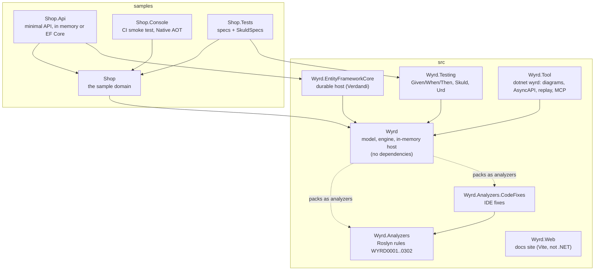

# Architecture

> Status: **describes the code as of `feature/retention` (PR #33, stacked on #11)**, written to make those PRs
> reviewable. [semantics.md](semantics.md) says what Wyrd must do; this document says how the code does it, where, and
> where the two disagree. Every claim cites the code as `path:line`; every quoted output comes from a real run, and
> the command is named next to it.
>
> Part 2, [runtime.md](runtime.md), covers sections 3 to 5 in depth: the engine branch by branch, the two hosts and one
> order end to end on PostgreSQL.

1. [The big picture](#1-the-big-picture)
2. [The model](#2-the-model)
3. [The engine](#3-the-engine) — summary, details in runtime.md
4. [The hosts](#4-the-hosts) — summary, details in runtime.md
5. [One order end to end](#5-one-order-end-to-end) — in runtime.md
6. [Patterns used, and where](#6-patterns-used-and-where)
7. [Invariants and where they are enforced](#7-invariants-and-where-they-are-enforced)
8. [How to review a PR in this repo](#8-how-to-review-a-pr-in-this-repo)
9. [Discrepancies and open questions](#9-discrepancies-and-open-questions)

---

## 1. The big picture

### The problem

A business process that spans several decisions — reserve stock, charge a card, wait for the bank, ship — has to
survive things that ordinary code ignores: a message delivered twice, two messages in the wrong order, a crash between
"charged the card" and "wrote that down", a customer who never confirms, a deploy in the middle of an order. Teams
usually solve this by hand in every handler (idempotency checks, retry loops, outbox tables, saga state), and get it
subtly wrong.

Wyrd splits the work: **teams write pure decisions and declare the process as data; Wyrd owns delivery, storage,
retries, time limits, compensation and deduplication.** Because the decisions are pure and the process is data, the
same code runs in a test, in a deterministic simulator of hostile futures (Skuld), in a replay of a production instance
(Urd) and on a real database (Verdandi).

### The five principles (from [semantics.md](semantics.md#principles))

1. **Decisions are pure; effects belong to Wyrd.** A slice returns an event or an error; it never saves, sends or
   schedules anything. The only I/O is an integration, and its outcome is recorded like a decision.
2. **Explicit over implicit.** No hidden defaults that change behaviour. Every step says how it retries, every wait
   how long it waits, every host how long it keeps data; analyzers ask when something is missing.
3. **Guarantees are not options.** Undos always retry; messages always commit with their effects.
4. **Nothing fails silently.** What Wyrd can't resolve becomes `Suspended` with a reason, never lost or stuck.
5. **Time limits are business decisions; slowness is not failure.** There are no technical timeouts on steps; a
   `.Within(...)` on a wait is a business rule.

### The projects



(From the `ProjectReference` items of each `.csproj`. `Wyrd.EntityFrameworkCore` depends on
`Microsoft.EntityFrameworkCore.Relational` only; the PostgreSQL or SQL Server provider is the application's choice.)

Inside `src/Wyrd`:

| Folder | What lives there |
|---|---|
| `Messages/` | `ICommand`, `IEvent`, `IDomainEvent`, `IIntegrationEvent`, `[IntegrationEvent]` |
| `Slices/` | `Slice<…>` (the decider), `IState<T>`, `Publication<…>`, `Upcaster<…>`, `Projection<T>` |
| `Integrations/` | `Integration<…>`, the only I/O |
| `Processes/` | `Process`, `ProcessBuilder<T>`, the nodes (`StepNode`, `AwaitNode`, `CompensatedNode`) |
| `Pipe/` | the opt-in `>>` syntax that builds the same `Process` |
| `Runtime/` | `Engine`, `IWyrdStore`, `InMemoryRuntime`, `InMemoryStore`, retention, transport, tracing |

### Glossary

| Name | Meaning | Where |
|---|---|---|
| **Skuld** | The Norn of what *will* be: runs a scenario in hundreds or thousands of hostile futures (reordered, duplicated, failing messages) and checks invariants. Deterministic: a seed is a future. | `src/Wyrd.Testing/Skuld.cs` |
| **Urd** | The Norn of what *was*: replays a recorded instance history against today's code and reports the first divergence. | `src/Wyrd.Testing/Urd.cs`, [urd.md](urd.md) |
| **Verdandi** | The Norn of what *is*: the v0.5 milestone, durable hosting (integrations and the EF Core host). | `src/Wyrd.EntityFrameworkCore`, [verdandi-efcore.md](verdandi-efcore.md) |
| **Slice** | The single owner of one command type: loads state by key, decides, evolves. A vertical slice. | `src/Wyrd/Slices/Slice.cs:7` |
| **Decider** | The pattern a slice implements: `Decide(command, state) → event or error` and `Evolve(state, event) → state`, both pure. | `Slice.Decide`, `IState<T>.Evolve` |
| **Process** | A linear business process as data: a trigger, steps and waits in order, an optional outcome when compensated. | `src/Wyrd/Processes/Process.cs:12` |
| **Step** | One node of a process: sends one command and waits for its reply; declares its retry and its undo. | `StepNode`, `ProcessNode.cs:141` |
| **Wait** | A node that waits for an event correlated by key, usually `.Within(duration)`. | `AwaitNode`, `ProcessNode.cs:170` |
| **Integration** | The owner of a command carried out by another system (a payment provider). The only place with I/O. | `src/Wyrd/Integrations/Integration.cs:17` |
| **Publication** | The explicit mapping from a domain event to a public integration event. | `src/Wyrd/Slices/Publication.cs:8` |
| **Projection** | A read model: a view updated from events by pure functions, in the transaction of the event. | `src/Wyrd/Slices/Projection.cs:19` |
| **Envelope** | The only thing that moves: id, kind (command, event, reply, timeout), type name, JSON payload, and routing data. | `src/Wyrd/Runtime/Messaging.cs:22` |
| **Journal** | A human-readable log of what the engine did ("-> ReserveStock", "ok StockReserved"). In memory, a list; on EF Core, `ILogger` at Debug. | `src/Wyrd/Runtime/JournalEntry.cs`, `InMemoryRuntime.cs:582` |
| **Instance** | One run of a process for one key (one order). One row in `wyrd.instances`. | `StoredInstance`, `Storage.cs:27` |
| **History** | What crossed an instance's boundary, in order; stored with the instance; what Urd replays. | `InstanceHistory`, `Engine.cs:868` |

---

## 2. The model

### 2.1 Three kinds of message, and why they never mix

| | Command | Domain event | Integration event |
|---|---|---|---|
| Meaning | an intention: *please do this* | a fact inside one context | a fact for other contexts |
| Interface | `ICommand` | `IDomainEvent` | `IIntegrationEvent` + `[IntegrationEvent("name", Version = n)]` |
| Who handles it | **exactly one** owner (slice or integration) | processes and projections of the same service | any number of subscribers, in any service |
| Can be rejected | yes | no | no |
| Changes freely | with its owner | yes, it is private | **no**: a versioned, snapshot-checked contract |
| Shop example | `ChargePayment` | `PaymentCharged` | `payments.payment-charged v1` (`PaymentChargedV1`) |

(`src/Wyrd/Messages/Messages.cs:7-31`, [messages.md](messages.md).)

**Why they never mix.** If another service subscribed to `PaymentCharged`, renaming a field in Payments would break
production somewhere else. So:

- a slice's event type is constrained to `IDomainEvent` (`Slice.cs:10`), so a slice *can't* produce an integration event;
- the only path from a domain event to an integration event is a registered `Publication` (`Engine.cs:155-164`);
- only integration events cross services: `ReceiveAsync` throws `NotAnIntegrationEventException` for anything else
  (`src/Wyrd/Runtime/Application.cs:70-73`);
- a command has one owner, checked at registration (`src/Wyrd/Runtime/Registry.cs:28-38`) and by WYRD0002;
- contracts are snapshotted in `samples/Shop/contracts.wyrd.txt` and a breaking change is a build error (WYRD0201).

### 2.2 Slices as deciders

```csharp
// samples/Shop/Payments/ChargePayment.cs:8-20
public sealed class ChargePaymentSlice : Slice<ChargePayment, Payment, PaymentCharged, PaymentError>
{
    public override object KeyOf(ChargePayment command) => command.OrderId;

    public override Result<PaymentCharged, PaymentError> Decide(ChargePayment command, Payment payment) => payment switch
    {
        Payment.None when command.Amount > CardLimit => PaymentError.CardDeclined,
        Payment.None => new PaymentCharged(command.OrderId, command.Amount),
        Payment.Charged or Payment.Refunded => PaymentError.AlreadyCharged,
    };
}
```

- `KeyOf` says which state the command decides on.
- `Decide` is pure and returns **at most one** event (a conscious limit, semantics § 2).
- The state type implements `IState<T>` with a static `Initial` and a pure `Evolve(event)` (`src/Wyrd/Slices/IState.cs:10-18`).
- Wyrd loads the state, calls `Decide`, and on acceptance stores `Evolve(state, event)` **as a snapshot**
  (`Engine.cs:115-126`). Events are kept as history, but state is not rebuilt from them (semantics § 2).

### 2.3 Processes as data

A process is a value: `Process` holds a name, a trigger type, a key function, an immutable array of nodes and an
optional outcome (`Process.cs:14-35`). There are three node types (`ProcessNode.cs:135-177`):

| Node | Data | Built by |
|---|---|---|
| `StepNode` | `Action` (a `StepRef`), `Compensation`, `Retry`, `NoRetryReason`, `NoCompensationReason`, `CompensateWhenExhausted`, `CompensationRetry` | `.Then(...)`, `.Retry`, `.NoRetry`, `.Undo`, `.NoCompensation`, `.OrCompensate` |
| `AwaitNode` | the event type, `Timeout`, the key function | `.Await<T>(key)`, `.Within(...)` |
| `CompensatedNode` | the outcome command and its retry | `.OnCompensated(...)` |

A `StepRef` (`ProcessNode.cs:37-133`) is a stable name for a step function (`Stock.Reserve`) plus a typed
`Invoke` delegate. Steps that read earlier events (`Ship(OrderPlaced order, PaymentCharged charged)`) are bound with
`Delegate.DynamicInvoke` (`ProcessNode.cs:101-106`).

**Two syntaxes, one model.** The fluent `ProcessBuilder<TTrigger>` (`src/Wyrd/Processes/ProcessBuilder.cs`) and the
pipe syntax (`src/Wyrd/Pipe/Pipeline.cs`) both end in `ProcessBuilder.Append` and share every modifier through
`NodeModifiers` (`ProcessNode.cs:180-265`). The pipe's `>>` operator is a C# 14 extension operator that calls
`Append` (`Pipeline.cs:26-35`). `fluent_and_pipe_build_the_same_process` (`tests/Wyrd.Tests/ProcessDslTests.cs:9`)
keeps them identical.

**Why data.** Because the process is a value, it can be rendered (`Process.ToMermaid`, `Process.cs:98-135`),
fingerprinted (`Process.cs:50-74`), simulated by Skuld, replayed by Urd, diffed in a snapshot
(`samples/Shop/processes.wyrd.txt`) and checked by analyzers (WYRD0011–0014), all without running it.

### 2.4 Integrations: the only I/O

```csharp
public abstract Task<Result<TEvent, TError>> ExecuteAsync(TCommand command, IntegrationContext context, CancellationToken ct);
```

(`src/Wyrd/Integrations/Integration.cs:26`). An integration owns a command like a slice does, so a process step can't
tell them apart. Three outcomes: `Ok(event)` accepted, `Error` rejected (never retried), exception → a transient
failure the step's policy handles. `context.IdempotencyKey` is the command's message id, the same on every retry
(`Engine.cs:96`, `Engine.cs:655-656`). The outcome is recorded in the owner's inbox, so a redelivery after the commit
never calls the provider again. See [integrations.md](integrations.md).

The Shop has no integration; tests use one (`tests/Wyrd.Tests/IntegrationTests.cs`).

---

## 3. The engine

`Engine` (`src/Wyrd/Runtime/Engine.cs`) handles **one** envelope and returns nothing but a set of `Changes`, which a
store commits atomically through `IWyrdStore.CommitAsync` (`Storage.cs:112-133`). It knows no database, no broker
and no wall clock: hosts pass in the store, the clock, the id generator, a fault hook and a logger
(`Engine.cs:10-17`). Four branches: commands (inbox check, fencing, decide or call the integration, record the reply),
events (project in stream order, start processes, resume or park waits), replies (advance, retry, compensate or
suspend; stale replies ignored) and timers (compensate on purpose). Operators resume or compensate a suspended instance.

→ The full walk-through, with the table of `Changes`, is [runtime.md § 3](runtime.md#3-the-engine).

## 4. The hosts

`IWyrdBuilder<T>` is what you register; `IWyrdRuntime` is what application code calls. Two hosts implement both:

- **`InMemoryRuntime`** — a list as the queue, a virtual clock, deterministic ids, one writer at a time. `SendAsync`
  returns when everything the command caused has run. Skuld and Urd plug in through internal hooks.
- **`EfCoreRuntime<TContext>`** — the queue is a table claimed with `FOR UPDATE SKIP LOCKED` (PostgreSQL) or
  `UPDLOCK, READPAST, ROWLOCK` (SQL Server); one transaction per message, including taking it off the queue;
  inbox and `handled` tables for duplicates; `published` as the outbox to other services; timers and retries as
  future queue rows; redelivery with backoff, faulted replies for process commands, dead letters for the rest;
  retention cleanup in the workers.

→ Tables, SQL from a real run, the worker loop and retention: [runtime.md § 4](runtime.md#4-the-hosts).

## 5. One order end to end

`PlaceOrder` to shipped on PostgreSQL with the rows written in each transaction, the same order with a declined card,
with a timeout and with a worker crash: [runtime.md § 5](runtime.md#5-one-order-end-to-end).

---

## 6. Patterns used, and where

| Pattern | Where | Why it is there | What breaks without it |
|---|---|---|---|
| **Decider** (functional event-driven aggregate) | `Slice<…>` (`src/Wyrd/Slices/Slice.cs:7-34`), `IState<T>.Evolve` (`IState.cs:10-18`), called at `Engine.cs:115-126` | Decisions are pure functions of (command, state): testable without infrastructure, replayable, simulable | Business code would do I/O; Skuld and Urd couldn't run it deterministically |
| **Process manager / saga with compensation** | `Process` and its nodes (`src/Wyrd/Processes/`), executed by `AdvanceAsync`, `HandleReplyAsync`, `StartCompensation`/`ContinueCompensation` (`Engine.cs:447-708`) | Coordinates steps owned by different slices, and undoes completed ones in reverse order when a step is rejected | A rejected payment would leave stock reserved forever (Skuld's `StockIsConserved` invariant, `samples/Shop.Tests/SkuldSpecs.cs:15`) |
| **Fencing token** | `Envelope.Fences` (`Messaging.cs:29`), `FenceAsync` (`Engine.cs:172-192`) | When a process gives up on a step without knowing if it ran, the undo either undoes it or makes sure it never runs | A late copy of a "given up" command could charge a card after its refund was skipped (`late_copies_of_a_fenced_command_never_execute`, `samples/Shop.Tests/FencingSpecs.cs:51`) |
| **Transactional outbox** | `Changes.Outbox`/`Schedule` → `queue` rows (`EfCoreStore.cs:152-161`); `Changes.Published` → `published` rows + relay (`EfCoreRuntime.cs:256-329`) | Messages produced by a decision are written in the same transaction as the decision | A crash between commit and send loses the message, or a send before commit publishes something that never happened |
| **Inbox / idempotent consumer** | `inbox` (commands, with their outcome) and `handled` (events): `Engine.cs:63-72`, `Engine.cs:217-221`; stable ids for retries (`Engine.cs:655-656`) and for messages from other services (`EfCoreRuntime.cs:224-225`) | Delivery is at least once; decisions must be effectively once | A redelivered `ChargePayment` charges twice; a retried integration calls the provider twice |
| **Competing consumers** | `Dialect.Dequeue` (`Dialect.cs:54-55`, `70-71`), `ProcessOneAsync` (`EfCoreRuntime.cs:371-402`) | Any number of workers share one queue table without a broker | One worker only, or two workers handling the same message at once |
| **Optimistic concurrency** | `WHERE version = …` on states and instances (`EfCoreStore.cs:182-231`), unique keys on inserted rows, version check in memory (`InMemoryStore.cs:71-96`); conflict → handle again (`EfCoreRuntime.cs:509-514`) | Two messages for the same key, on two workers, must not both win | Lost updates: two orders reserve the last keyboard |
| **Upcasting / versioned contracts** | `Upcaster<TFrom,TTo>`, `Registry.Add(IUpcasterHandler)` (`Registry.cs:42-54`), `Engine.Accept(IEvent, Type)` (`Engine.cs:417-443`); snapshots + WYRD0200–0204 | A subscriber receives the contract version it understands, upcast step by step | A publisher's v2 breaks every v1 subscriber |
| **Snapshot state** (state-stored aggregate) | `states.payload` with `version` (`WyrdModel.cs:180-188`), written at `Engine.cs:122-124` | Simple storage and one-row reads | — (the alternative, event sourcing, is a declared future option). Cost: a state that grows makes every message slower (Q2.1) |
| **Read-model projections** with a **resequencer** | `Projection<T>`, `Engine.ProjectInOrderAsync` (`Engine.cs:252-288`), `held` and `projected` tables | Views updated in the event's transaction, in stream order whatever the delivery order | Views that go backwards ("Shipped" then "Paid") when events arrive out of order |
| **Parking (early events)** | `Changes.Park`, `parked` table, `ResumeOrParkAsync` (`Engine.cs:373-381`), taken at `Engine.cs:458-468` | An awaited event may arrive before the process reaches the wait | A webhook that beats the payment reply is lost and the order times out |
| **Deterministic simulation testing** | `ISimulation` (`src/Wyrd/Runtime/ISimulation.cs`), `Skuld` (`src/Wyrd.Testing/Skuld.cs`), `samples/Shop.Tests/SkuldSpecs.cs` | Explores thousands of reorderings, duplicates and faults, reproducible by seed, shrunk to a minimal future | Concurrency bugs found in production instead of CI |
| **Record and replay** | `InstanceHistory`, `Engine.Record` (`Engine.cs:868-899`), `Urd` (`src/Wyrd.Testing/Urd.cs`), `InMemoryRuntime.Responder` | Turn a misbehaving production instance into a regression test | "Can't reproduce" |
| **AOT-friendly source-generated JSON** | `MessageTypes.FromContext` (`MessageTypes.cs:26`), `[WyrdJsonContext]`, the app's context (`samples/Shop/ShopJson.cs`), Wyrd's own `WyrdJsonContext` (`Runtime/WyrdJsonContext.cs`); reflection only behind `[RequiresUnreferencedCode]` (`MessageTypes.cs:29-32`, `InMemoryRuntime.cs:32-37`); WYRD0300–0302 | Native AOT and trimming: no runtime code generation, types resolved by registered name | AOT publish fails or a type silently loses its JSON metadata at run time |

---

## 7. Invariants and where they are enforced

| Invariant | Enforced by (code) | Guarded by (tests, analyzers) |
|---|---|---|
| **A command has exactly one owner** | `Registry.Add(ICommandOwner)` throws on a second owner (`Registry.cs:28-38`) | WYRD0002; `a_command_has_one_owner_slice_or_integration` (`tests/Wyrd.Tests/IntegrationTests.cs:94`) |
| **One instance per process and key** (while it is kept) | `StartAsync` checks `Changes` and the store (`Engine.cs:327-332`); the `instances` primary key `(process, key)` (`WyrdModel.cs:192`) | `a_redelivered_integration_event_starts_a_single_instance` (`tests/Wyrd.Tests/RuntimeTests.cs:177`); `once_its_instance_is_forgotten_a_key_can_start_a_new_one` (`tests/Wyrd.Tests/RetentionTests.cs:38`) |
| **A decision is effectively once** | inbox check before deciding (`Engine.cs:63-72`); reply stored in the same commit (`Engine.cs:142-144`); inbox primary key (`WyrdModel.cs:233`) | `a_message_delivered_twice_is_handled_once` (`tests/Wyrd.EntityFrameworkCore.Tests/EfCoreRuntimeTests.cs:364`, `tests/Wyrd.Tests/TransportTests.cs:30`); `skuld_finds_no_future_where_a_card_is_charged_twice` (`tests/Wyrd.Tests/IntegrationTests.cs:129`) |
| **Everything one message changes commits together** | one `CommitAsync(Changes)` per branch (runtime.md § 3.3); on EF Core inside the transaction that deletes the queue row (`EfCoreRuntime.cs:388-394`) | `wyrd_commits_together_with_the_applications_own_tables` (`tests/Wyrd.EntityFrameworkCore.Tests/EfCoreRuntimeTests.cs:286`); `SkuldSpecs` |
| **Business rejections are never retried** | `Rejected` → compensation, `Faulted` → retry (`Engine.cs:578-587`) | `a_rejected_step_compensates_only_what_completed` (`RuntimeTests.cs:49`) |
| **One retry layer** | a failed process command becomes a `Faulted` reply, never a host retry (`EfCoreRuntime.cs:523-538`) | `a_process_command_the_host_cant_handle_reaches_its_process_as_a_failure` (`tests/Wyrd.EntityFrameworkCore.Tests/EfCoreRuntimeTests.cs:201`) |
| **Undos always insist** | `RetryPolicy.Undo`, 10 exponential retries, no way to disable (`ProcessNode.cs:18`, `ProcessNode.cs:156`) | `an_undo_insists_through_transient_failures` (`RuntimeTests.cs:202`) |
| **A given-up step is fenced, never guessed** | `CompensateUncertain` + `FenceAsync` (`Engine.cs:621-634`, `Engine.cs:172-192`) | `samples/Shop.Tests/FencingSpecs.cs:43-51` |
| **Nothing fails silently** | `Suspend` keeps position and reason (`Engine.cs:714-724`) | `exhausted_retries_suspend_instead_of_guessing` (`RuntimeTests.cs:83`); Skuld's `EveryOrderEndsOrIsFlagged` (`SkuldSpecs.cs:34`) |
| **An instance never continues on a changed definition** | fingerprint checks (`Engine.cs:356`, `532`, `834`, `797`) | `tests/Wyrd.Tests/FingerprintTests.cs:34-82` |
| **A wait's timer lives only as long as the wait** (Q2.2) | `EndWait` adds the timer to `Cancel` (`Engine.cs:394-402`) | `a_wait_that_ends_cancels_its_timer` (`RuntimeTests.cs:27`); seen live in runtime.md § 5.1 |
| **Read models see one stream in order** | `ProjectInOrderAsync` (`Engine.cs:252-288`), `projected` version checked on commit (`EfCoreStore.cs:122-135`) | `a_view_sees_the_events_of_a_stream_in_the_order_they_happened` (`tests/Wyrd.Tests/OrderedProjectionTests.cs:43`); `read_models_keep_their_stream_order` (`tests/Wyrd.EntityFrameworkCore.Tests/EfCoreRuntimeTests.cs:68`) |
| **The runtime is deterministic** (in memory) | virtual clock (`InMemoryRuntime.cs:14`, `24`), counter ids (`InMemoryRuntime.cs:566-572`), FIFO queue, ordered collections | `the_same_inputs_produce_the_same_journal` (`RuntimeTests.cs:226`); `tracing_does_not_change_the_shop_journal_ids_domain_state_or_replay_history` (`tests/Wyrd.Tests/TracingTests.cs:21`) |
| **Only integration events cross services** | `Application.Uses` (`Application.cs:62-76`) | `only_integration_events_cross_service_boundaries` (`tests/Wyrd.Tests/TransportTests.cs:83`) |
| **State is bounded** (Q2.1, Q2.3) | `Retention` with every member `required` (`src/Wyrd/Runtime/Retention.cs:48-72`); cleanup (`EfCoreRuntime.cs:409-491`, `InMemoryStore.cs:174-203`); journal cap (`InMemoryRuntime.cs:582-593`). Domain state is the application's job | `tests/Wyrd.Tests/RetentionTests.cs`; `retention_forgets_what_expired_and_keeps_the_rest`, `a_suspended_instance_never_expires` (`tests/Wyrd.EntityFrameworkCore.Tests/EfCoreRuntimeTests.cs:441`, `471`). **Not yet:** the benchmark gate (task 014) and the Shop's own state (task 016; see § 9) |
| **Every step and wait declares its decisions** | the builder records `NoRetryReason` etc. | WYRD0011–0014 (`src/Wyrd.Analyzers/Diagnostics.cs`) |

The Skuld specs that must stay green on every engine change: `the_business_holds_in_every_future` (200 futures) and
`nothing_is_lost_in_thousands_of_hostile_futures` (5,000 futures, 20% faults, 20% duplicates, 50% reordering)
(`samples/Shop.Tests/SkuldSpecs.cs:53`, `69`). Note what they do *not* cover in § 9.

---

## 8. How to review a PR in this repo

### High-risk files

| File | Why it is risky | What to look for |
|---|---|---|
| `src/Wyrd/Runtime/Engine.cs` | Every guarantee lives here | Does every branch end in **one** `CommitAsync`, or return having changed nothing? Is anything written outside `Changes`? Does a new reply path keep the stale-reply check (`Engine.cs:519-525`)? Are retries re-sending the **same** message id? Does a new instance field get recorded in history when it crosses the boundary? Any wall clock, randomness or unordered iteration? |
| `src/Wyrd/Runtime/Storage.cs` (`Changes`, `IWyrdStore`) | A new member means every store must commit it | Is the new member committed by `InMemoryStore.CommitAsync` **and** `EfCoreStore.CommitAsync`, with the same conflict semantics? |
| `src/Wyrd/Runtime/InMemoryStore.cs` | The reference store and what Skuld tests | Versions checked **before** any write; retention mirrors the EF Core one |
| `src/Wyrd.EntityFrameworkCore/EfCoreRuntime.cs` | Transactions, workers, redelivery | Is every write inside the message's transaction? Is a failure recorded only after re-taking the unchanged row (`EfCoreRuntime.cs:516-521`)? Can a concurrency conflict be mistaken for a failure, or the other way round? Anything blocking (`.Result`, `.Wait()`) or holding a transaction across slow I/O? |
| `src/Wyrd.EntityFrameworkCore/EfCoreStore.cs` | Translates `Changes` into SQL | Every update of a versioned row has its version in the `WHERE` and checks the row count |
| `src/Wyrd.EntityFrameworkCore/Dialect.cs` | Raw SQL and locking hints | Same semantics on both databases; columns match `WyrdModel.cs`; conflict codes complete |
| `src/Wyrd.EntityFrameworkCore/WyrdModel.cs` | The schema; changing it means a migration in every application | Indexes for every column retention or the claim filters on; `CHANGELOG.md` says a migration is needed |
| `src/Wyrd/Processes/*` | The fingerprint and both syntaxes | Does the change alter `Fingerprint` for existing processes (it suspends every instance in flight)? Does the pipe syntax get the same modifier through `NodeModifiers`? |

### Tests that must stay green

```bash
dotnet build                                   # warnings are errors
dotnet test                                    # everything, including the EF Core tests (needs Docker)
dotnet test samples/Shop.Tests --filter "FullyQualifiedName~SkuldSpecs"   # the hostile futures
dotnet run --project samples/Shop.Console      # the CI smoke test
```

On this branch `dotnet build` reported `0 Warning(s)`, `0 Error(s)`, and `dotnet test` reported:

```text
Passed!  - Failed:     0, Passed:   176, Skipped:     0, Total:   176, Duration: 2 s - Wyrd.Tests.dll (net10.0)
Passed!  - Failed:     0, Passed:    73, Skipped:     0, Total:    73, Duration: 3 s - Wyrd.Analyzers.Tests.dll (net10.0)
Passed!  - Failed:     0, Passed:   118, Skipped:     0, Total:   118, Duration: 4 s - Shop.Tests.dll (net10.0)
Passed!  - Failed:     0, Passed:    73, Skipped:     0, Total:    73, Duration: 6 s - Wyrd.Tool.Tests.dll (net10.0)
Passed!  - Failed:     0, Passed:    48, Skipped:     0, Total:    48, Duration: 32 s - Wyrd.EntityFrameworkCore.Tests.dll (net10.0)
```

### The durable tests

`tests/Wyrd.EntityFrameworkCore.Tests` start one PostgreSQL 17 and one SQL Server container with Testcontainers
(`Databases.cs`), give every test its own database created with `EnsureCreated`, and run every test on both
(`EfCoreRuntimeTests.cs:17-24`: `OnPostgreSql` and `OnSqlServer` derive from the same abstract class). They need a
running Docker daemon and nothing else. Run only them with:

```bash
dotnet test tests/Wyrd.EntityFrameworkCore.Tests
```

To see the durable host by hand, follow runtime.md § 5 (and read § 9 first: the documented command fails on the second
start).

### Questions to ask of any engine or host PR

1. Which **invariant** of § 7 does this touch, and which test proves it still holds?
2. Does it change the **journal** of `samples/Shop.Console`? (Skuld's determinism depends on it.)
3. Does it change a **table**? Then where is the migration note?
4. Does it add a **state or row that only grows**? What removes it?
5. Benchmark numbers before and after (quality bar Q1.4), for `src/Wyrd/Runtime` changes.

---

## 9. Discrepancies and open questions

Found while writing this document. **Nothing here was fixed**: this PR changes documentation only. "Verified" means
reproduced in a run; "from the code" means read, reasoned about, not reproduced.

### 9.1 Contradicts semantics.md or another design document

1. **A fence lasts only as long as `Retention.Deduplication`, not forever.** Semantics 3.4: the owner "blocks it
   forever if it didn't [run]". The fence is a `Fenced` reply in the inbox (`Engine.cs:181-185`), and the inbox is
   deleted after the deduplication period (`EfCoreRuntime.cs:414-418`, `InMemoryStore.cs:179-182`). A late copy of a
   fenced command arriving after that window would execute. *From the code.*
2. **Resuming after the deduplication window can run a command twice.** Semantics 3.6: `ResumeAsync` re-sends "with
   the same message id (a command that did run is not run twice)". That relies on the inbox row
   (`Engine.cs:804-814` + `Engine.cs:63-72`). Suspended instances never expire, but their inbox rows do, so a suspended
   instance resumed after 7 days (the Shop's setting, `DurableHost.cs:13`) re-executes a command that may have run.
   *From the code.*
3. **The in-memory host has no "one retry layer".** Semantics 3.3 says a command that can't be handled "ends as a
   failure reply … Implemented in memory and on the EF Core host". In memory, only injected faults (`FailNext`, Skuld)
   become `Faulted` replies (`Engine.cs:74-80`). A real exception (a bug in `Decide`, a missing JSON type) propagates
   out of `DrainAsync` to the caller of `SendAsync`/`PublishAsync`; the envelope was already removed from the queue
   (`InMemoryRuntime.cs:357-375`), so it is dropped, and the rest of the queue waits for the next call. *From the code.*
4. **Skuld does not simulate crashes, nor the durable host.** distributed.md, *Testing*: "Skuld: deterministic
   simulation of crashes at every commit point". `ISimulation` has three decisions: reorder, duplicate, fault
   (`src/Wyrd/Runtime/ISimulation.cs:7-17`), and Skuld only drives `InMemoryRuntime` (`Skuld.cs:26`). No crash, no
   delay, nothing on EF Core. The EF Core host is covered by its own 48 tests, not by explored futures.
5. **messages.md describes APIs and files that don't exist.** `.AlsoPublish<…>()` and `.Retire<…>()` (no match under
   `src/`), and per-event JSON snapshots (`contracts/payments.payment-charged.v1.json`); the real snapshot is one text
   file, `samples/Shop/contracts.wyrd.txt`. (Two contract versions are published by registering two publications,
   `Publication.cs:5-6`.)
6. **verdandi-efcore.md § 8 says "Dates are indexed"**, but `dead_letters.failed_at`, which retention deletes by, has no
   index (`WyrdModel.cs:299-307`). Every other retention column is indexed.
7. **distributed.md is out of date** as a description (it says so itself: "proposal"): table names (`wyrd_state`,
   `wyrd_outbox`…), "timeouts are a `deadline` column polled" (they are queue rows; `deadline` is informational), and the
   `ISlice` / `IIntegration.Run` shapes differ from `Slice<…>` / `Integration<…>.ExecuteAsync`.
8. **`Storage.cs:108-110` and `Engine.cs:8`** still say "In-memory and PostgreSQL implement it" / "future
   database/broker hosts"; the implementations are `InMemoryStore` and `EfCoreStore`.

### 9.2 Looks wrong (bugs or risks), not covered by tests

9. **The durable Shop API fails on its second start with the documented setup. Verified.** `compose.yaml` creates a
   PostgreSQL user named `wyrd`, the same as Wyrd's schema. PostgreSQL's default `search_path` is `"$user", public`, and
   EF Core's history table `__EFMigrationsHistory` is unqualified. First start: schema `wyrd` doesn't exist yet, so the
   history table and its `InitialWyrd` row go to `public`. Second start: schema `wyrd` exists, `"$user"` resolves to it,
   EF creates an empty `wyrd.__EFMigrationsHistory`, decides nothing was applied, and re-runs the migration:

   ```text
   fail: Microsoft.Extensions.Hosting.Internal.Host[11]
         Hosting failed to start
         Npgsql.PostgresException (0x80004005): 42P07: relation "dead_letters" already exists
   ```

   (From `dotnet run --project samples/Shop.Api -p:WyrdHost=EfCore` against `compose.yaml`, after one successful
   start.) Adding `Search Path=public` to the connection string works around it. The tests don't catch it: they use
   the `postgres` user and `EnsureCreated`, not migrations (`tests/Wyrd.EntityFrameworkCore.Tests/Databases.cs:28`,
   `84`). This contradicts `Shop.Api.http`: "stop and start the API at any point: every order continues where it was".
   It also affects any application whose database user has the schema's name.
10. **Integration I/O runs inside the queue transaction.** On EF Core, `ProcessOneAsync` opens a transaction and locks
    the queue row (`EfCoreRuntime.cs:375-382`), then the engine awaits `integration.ExecuteAsync` (`Engine.cs:96`). A
    slow provider holds a database transaction and connection for the length of the HTTP call; a provider that hangs
    holds them indefinitely (semantics 3.5: no technical timeouts). Not stated in integrations.md or verdandi-efcore.md.
    *From the code.*
11. **A crash is not a failed attempt.** `attempts` grows only in `RedeliverLaterAsync`, which runs only when handling
    *throws* (`EfCoreRuntime.cs:395-399`, `553-556`). A message that kills the process (out of memory, stack overflow,
    `FailFast`) is rolled back with `attempts` unchanged and `available_at` in the past, so it is claimed again
    immediately, by every worker in turn, forever, never reaching the dead letters. *From the code.*
12. **Read-model writes have no concurrency check across streams.** `projected` protects one stream's order, but the
    view row is updated without a version (`EfCoreStore.cs:233-249`). `OrderSummaries` is fed by events of three
    streams (`Order`, `StockItem` keyed by SKU, `Payment`: `samples/Shop/Orders/OrderSummaries.cs:23-29`). Two workers
    handling, say, `StockReserved` and `PaymentCharged` for the same order at the same time both read the view, and the
    second `UPDATE` overwrites the first (lost update under READ COMMITTED). Semantics § 5 says cross-stream views
    "tolerate reordering", which is a different problem. The Shop API runs one worker, so it doesn't show. *From the
    code.*
13. **Rows that never expire.** (a) `held`: an event waits for an earlier event of its stream; if that one ends in the
    dead letters (a projection that throws), the held one and every later one of the stream wait forever, invisible
    (`BacklogAsync` counts queue and dead letters only, `EfCoreRuntime.cs:660-665`). (b) `parked` rows for a key that
    never gets an instance (`Engine.cs:373-381` parks when `instance is null`): only a removed *instance* takes its
    parked events with it (`EfCoreRuntime.cs:485-486`), and `parked` has no date column. Both contradict "everything a
    host keeps has a retention" (semantics 4.1, Q2.3). *From the code.*
14. **Conflict retries are immediate and unbounded in the worker.** A conflict returns without delay or count
    (`EfCoreRuntime.cs:510-514`); under contention on one hot key (one SKU) workers spin. `SendAsync` from outside is
    bounded (`MaxConflictRetries`), the worker path is not. *From the code.*
15. **`SendAsync` retries a conflict with a new message id.** `HandleAsync` creates `Guid.CreateVersion7()` on every
    attempt (`EfCoreRuntime.cs:155-169`, `232`). For an integration owner this means a different idempotency key per
    attempt. Integrations write no versioned rows, so a conflict there is unlikely, but the statement "the same on every
    retry and redelivery" (`Integration.cs:23-25`) doesn't hold for this path. *From the code.*
16. **Operator actions and `PublishAsync`/`ReceiveAsync` don't translate conflicts into `ConcurrencyConflictException`.**
    `OperateAsync` (`EfCoreRuntime.cs:578-586`) lets a raw `DbUpdateException` (unique violation) or the store's
    `ConcurrencyConflictException` out, with no retry; Q4.1 says what a host handles is typed. *From the code.*

### 9.3 The sample

17. **`StockItem.Reservations` keeps shipped orders. Verified.** After A-1001 shipped, the KEYBOARD state is
    `{"Available":3,"Reservations":{"A-1001":1,"A-1003":1}}` (`psql` in runtime.md § 5). This is the Q2.1 problem the
    quality bar describes; task 016 owns it.
18. **`OrderDetail` never says "Shipped". Verified.** `GET /orders/A-1001` after shipping returned
    `"order":{…"status":"Shipped"}` but `"details":{…"status":"Placed"}`: `OrderDetails` has no handler for
    `OrderShipped` (`samples/Shop/Orders/OrderDetails.cs:14-24`).
19. **`OrderShippedV1.ShippedOn` is a constant.** `OrderShippedPublication` returns `new DateOnly(2026, 10, 16)` for every
    order (`samples/Shop/Shipping/ShipOrder.cs:44`; the console run printed `ShippedOn = 16/10/2026` for both shipped
    orders). Publications are pure and get no clock, so a real date has to come from the event. Is that intended for the
    sample, or a gap in the model ("what time is it" inside a decision)?

### 9.4 Open questions

20. **AOT and steps that read events.** `StepRef.Bind` uses `Delegate.DynamicInvoke` for steps with extra parameters
    (`ProcessNode.cs:101-106`, `115-126`), and `StepRef.Untyped` reads `MethodInfo.GetParameters()`
    (`ProcessNode.cs:67-85`), neither behind `[RequiresUnreferencedCode]`. The AOT smoke test uses the Shop, whose
    process has no such step, so this path is not verified under Native AOT.
21. **`Application.Uses` is broader than its comment.** The comment says a contract is used "by a process, a
    projection or an upcaster"; the code checks only that the type is registered (`Application.cs:58-76`), which
    includes contracts this service itself *publishes*. Harmless (the event is marked handled), but the "ignored"
    log line (`EfCoreRuntime.cs:216-219`) won't appear for them.
22. **Small code-hygiene items:** two stacked `<summary>` comments on `InMemoryRuntime.Scheduled`
    (`InMemoryRuntime.cs:526-527`); duplicated `[JsonSerializable]` attributes in `WyrdJsonContext`
    (`WyrdJsonContext.cs:6-10`).
23. **Observed once, not reproduced:** the very first start of the API during this work failed to bind port 5080
    (another application used it) *after* the migration had run; the next start then failed with the error of item 9.
    It is the same cause, not a partial migration: verified by recreating the database and starting twice.

### What could not be verified

- A timeout on PostgreSQL in real time (it would take 15 minutes; the API uses the system clock). Shown in memory and
  covered by `a_timeout_fires_from_the_durable_timer` on both databases.
- A crash in the middle of a message, on purpose. The kill shown in runtime.md § 5.4 happened while the instance was
  waiting, between messages.
- SQL Server by hand: only through the test suite (which passed).
- Items marked *from the code* in this section.
