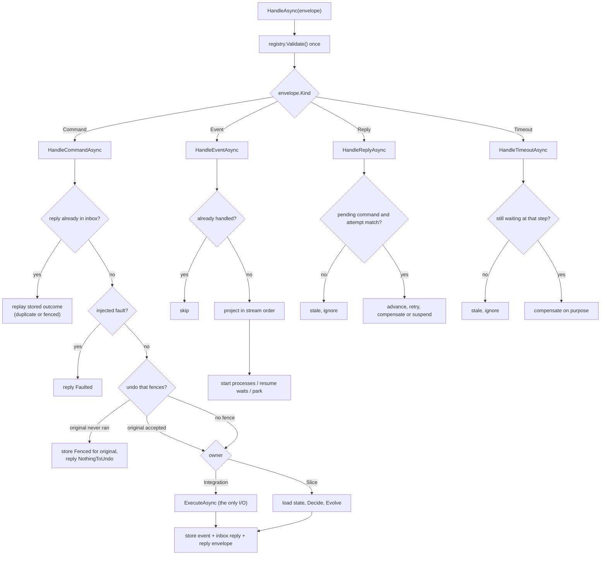
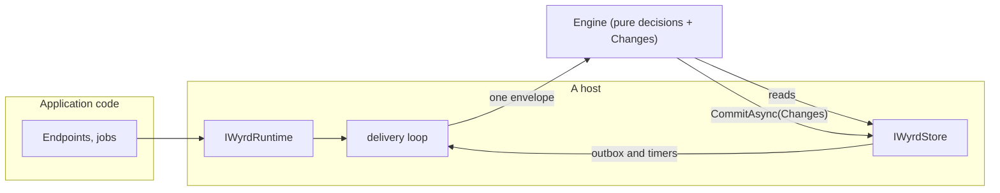
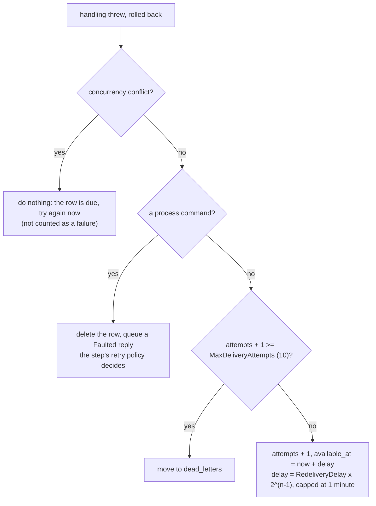
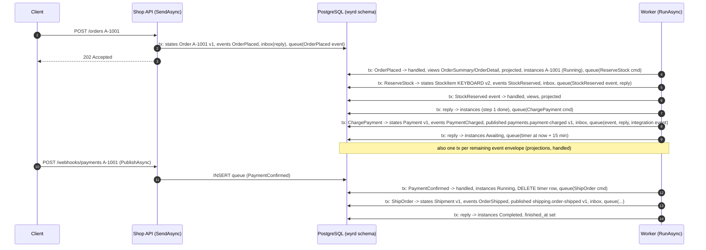
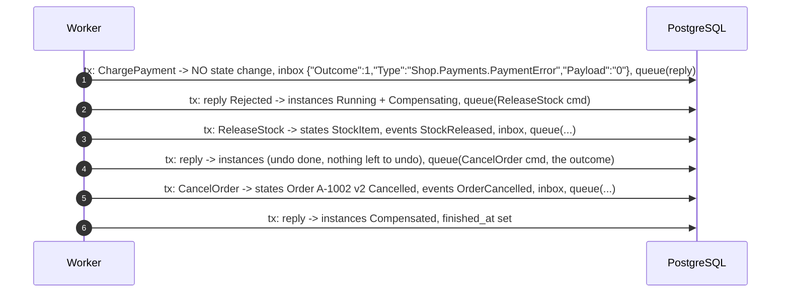
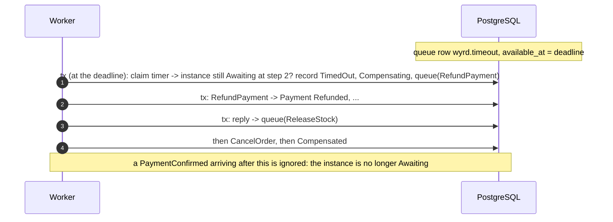
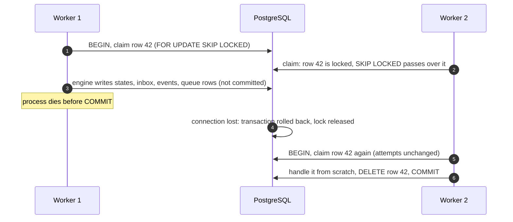

# Architecture, part 2: the engine, the hosts, one order end to end

> Status: **describes the code as of `feature/retention` (PR #33, stacked on #11)**. Part 1 is
> [architecture.md](architecture.md): the big picture, the model, the patterns, the invariants, how to review and the
> discrepancies found while writing this. When this document and [semantics.md](semantics.md) disagree, semantics wins
> and the disagreement is listed in [architecture.md § 9](architecture.md#9-discrepancies-and-open-questions).
>
> Every claim cites the code as `path:line`. Every log line, SQL statement and table row quoted here comes from a real
> run; the command is named next to it.

- [3. The engine](#3-the-engine)
- [4. The hosts](#4-the-hosts)
- [5. One order end to end](#5-one-order-end-to-end)

---

## 3. The engine

### 3.1 What it is, and why it is shaped like this

`Engine` (`src/Wyrd/Runtime/Engine.cs:10`) is the whole of Wyrd's behaviour at run time. It has one job:

> Take **one** `Envelope`, decide what changes, and hand those changes to a store to commit **atomically**.

It is built with seven collaborators (`Engine.cs:10-17`), and none of them is a database or a broker:

| Parameter | What the host gives it | In memory | On EF Core |
|---|---|---|---|
| `Registry registry` | The slices, integrations, publications, upcasters, projections and processes | `Application.Registry` | same |
| `IWyrdStore store` | Reads, and one `CommitAsync(Changes)` | `InMemoryStore` | a new `EfCoreStore` per message, bound to its transaction |
| `MessageTypes types` | Type name ↔ JSON | same object | same object |
| `Func<DateTimeOffset> now` | The clock | the virtual clock | the time the message was claimed |
| `Func<Guid> newId` | Message ids | deterministic counter (`InMemoryRuntime.cs:566-572`) | `Guid.CreateVersion7` (`EfCoreRuntime.cs:670`) |
| `Func<Envelope, Type, bool> fault` | "Fail this command transiently" | `FailNext` and Skuld (`InMemoryRuntime.cs:541-553`) | always false (`EfCoreRuntime.cs:670`) |
| `Action<string, string?, string> log` | The journal | the in-memory journal | `ILogger` at Debug (`EfCoreRuntime.cs:690-693`) |

**Why.** Because the engine never touches storage, transport or the wall clock, the same code runs in a unit test, in
Skuld's thousands of simulated futures, in an Urd replay and on PostgreSQL. Determinism comes from the host
passing a virtual clock and a counter for ids; durability comes from the host passing a store that writes in a
transaction. A future host (RabbitMQ, another database) is a new store and a new loop, not a new engine.

### 3.2 The envelope: the only thing that moves

```csharp
// src/Wyrd/Runtime/Messaging.cs:22-31
internal sealed record Envelope(
    Guid MessageId, MessageKind Kind, string Type, string Payload,
    ProcessRef? Process = null,   // which instance, step, phase and attempt this belongs to
    Guid? ReplyTo = null,         // on a reply: the command it answers
    Guid? Fences = null,          // on an undo of an uncertain step: the original command id
    StreamRef? Stream = null,     // on a domain event: the state it changed and its new version
    TraceContext? Trace = null);  // diagnostic only
```

There are four kinds (`Messaging.cs:3-9`): `Command`, `Event`, `Reply` and `Timeout`. `Type` is the registered name
of the payload type (`MessageTypes.NameOf`, `MessageTypes.cs:34`: the contract name for an integration event, the full
type name otherwise), and `Payload` is JSON. Nothing typed crosses a boundary; types are resolved by name from the
registry, never with `Type.GetType` (`MessageTypes.cs:59-62`).

A reply carries a `ReplyMessage` (`Messaging.cs:50`) with one of five outcomes (`Messaging.cs:36-47`):
`Accepted`, `Rejected`, `Faulted`, `Fenced` (stored for a command that must never run) and `NothingToUndo`.

### 3.3 `Changes`: what one message did

`Changes` (`src/Wyrd/Runtime/Storage.cs:60-106`) is a bag of everything one envelope changed. The engine fills it; the
store commits it in one go.

| Member | What goes in it | Committed as (EF Core, `EfCoreStore.cs:66-170`) |
|---|---|---|
| `States` | A slice's new state, with the version being written | `UPDATE states … WHERE version = v-1`, or `INSERT` for version 1 |
| `Instances` | Process instances, with the version **read** | `UPDATE instances … WHERE version = read`, or `INSERT` |
| `Events` | Accepted domain events (the record of facts) | `INSERT events` |
| `Published` | Integration events for other services | `INSERT published` (the outbox to other services) |
| `Replies` | The inbox: the outcome of a command, by command id | `INSERT inbox` |
| `Outbox` | Envelopes to deliver next (events, commands, replies) | `INSERT queue` (available now) |
| `Schedule` | Envelopes to deliver later (timers, retries) | `INSERT queue` (available later) |
| `Cancel` | Ids of scheduled envelopes no longer wanted (a wait's timer) | `DELETE queue WHERE message_id = ANY(...)` |
| `Park` / `Unpark` | Awaited events that arrived early, and their release | `INSERT parked` / `DELETE parked` |
| `Views` | Read-model documents (null payload deletes) | `UPDATE views`, else `INSERT`; or `DELETE` |
| `Projected` | Per stream: the version read and the version now projected | `UPDATE projected … WHERE version = read`, or `INSERT` |
| `Hold` / `Release` | Domain events held back until their stream's gap fills | `INSERT held` / `DELETE held` |
| `Handled` | Ids of events handled (dedup for events) | `INSERT handled` |

The engine never reads its own uncommitted writes from the store; when it needs one (a view projected twice in the
same message, an instance created and then advanced) it looks in `Changes` first (`Engine.cs:308-310`, `Engine.cs:327`,
`Engine.cs:458`).

### 3.4 `HandleAsync`, branch by branch



Every branch ends with exactly one `store.CommitAsync(changes)` (or returns without committing when there is nothing
to change). `registry.Validate()` (`Engine.cs:28`, `Registry.cs:95-128`) runs once, before the first message, and
fails the application if a step reads an event no earlier step produces.

#### Command to a slice (`Engine.cs:55-146`)

1. Deserialize the command and find its single owner (`Engine.cs:57-59`). The owner's `KeyOf` gives the state key.
2. **Inbox check** (`Engine.cs:63-72`): if a reply for this message id is stored, this is a duplicate (or a late copy
   of a fenced command). The stored outcome is replayed to the process and nothing is decided again.
3. **Injected fault** (`Engine.cs:74-80`): only for process commands, only when the host says so (tests and Skuld).
4. **Fencing** (`Engine.cs:82-86`, `Engine.cs:172-192`): see "Resume and compensate" below.
5. **Decide** (`Engine.cs:113-127`): load the state (or the slice's `Initial`), call the pure `Decide`. If accepted,
   call `Evolve` (`IState<T>.Evolve`, reached through `IState.Apply`, `src/Wyrd/Slices/IState.cs:15-17`), write the
   new state with version + 1, and record the event (`Accept`, `Engine.cs:149-165`).
6. **Record the outcome** (`Engine.cs:129-145`): the reply goes into the inbox (`changes.Replies`) and, if a process
   sent the command, a reply envelope goes into the outbox (`Engine.cs:194-200`).

`Accept` (`Engine.cs:149-165`) does three things with an accepted event: stores it (`Events`), queues it as an
`Event` envelope carrying its `StreamRef` (state type, key, new version) so processes and projections react to it,
and runs every **publication** registered for its type, which adds a `Published` row and an outbox envelope for the
integration event.

#### Command to an integration (`Engine.cs:89-112`)

Same as a slice up to step 4, then `ExecuteAsync` is called with an `IntegrationContext(envelope.MessageId,
attempt)` (`Engine.cs:96`). The message id is the idempotency key: retries re-send the same id (`Engine.cs:655-656`), so
a provider that deduplicates by key never charges twice.

- `Ok(event)` → accepted, recorded like a slice's event, but with no state and no stream (`Engine.cs:108-111`).
- `Error` → rejected; never retried.
- An exception, **for a process command** → a `Faulted` reply committed with nothing else (`Engine.cs:98-106`): the
  step's retry policy decides. For a command sent from outside (`SendAsync`), the exception reaches the caller
  (the filter `when (envelope.Process is not null …)` lets it through). Tested by
  `sent_directly_an_integration_answers_and_its_failure_reaches_the_caller`
  (`tests/Wyrd.Tests/IntegrationTests.cs:103`).

#### Domain event: projections and processes (`Engine.cs:215-246`)

1. **Dedup** (`Engine.cs:217-221`): events are deduplicated by the `handled` set, not the inbox.
2. **Read models in stream order** (`Engine.cs:252-288`): if the event carries a `StreamRef`, the engine compares its
   version with the last version of that stream projected (`LoadProjectedAsync`).
   - already projected → skip;
   - a gap (version > projected + 1) → **hold** it (`Engine.cs:271-276`);
   - next in line → project it, then release any held successors in order (`Engine.cs:278-287`).
   Integration events from outside have no stream and are projected as they come (`Engine.cs:259-263`).
3. **Processes** (`Engine.cs:229-243`): for every active process, if the event (or an upcast of it) is the trigger,
   `StartAsync`; for every `Await` node waiting for that type, `ResumeOrParkAsync`.

`StartAsync` (`Engine.cs:324-342`) refuses a second instance for the same process and key ("duplicate … ignored"),
creates a `StoredInstance` with the trigger, the process **fingerprint** and a `Started` history entry, and advances it.

`ResumeOrParkAsync` (`Engine.cs:344-382`) has four outcomes:

| Instance state | What happens |
|---|---|
| Awaiting, but its definition changed | park the event at the step it waits at, suspend (`Engine.cs:356-361`) |
| Awaiting at this step | record `Received`, cancel the wait's timer (`EndWait`), add the event to the instance's facts, advance (`Engine.cs:362-372`) |
| No instance yet, or running before this step, or suspended at or before it | **park** it for later (`Engine.cs:373-381`) |
| Anything else (already past it, compensating, finished) | ignored |

**Upcasting** happens here too: `Accept(IEvent, Type wanted)` (`Engine.cs:417-443`) hands a subscriber the version of an
integration event it understands, upcasting step by step with registered upcasters, never downcasting, and skipping the
upcast when the publisher also publishes a closer version.

#### Advancing a process (`Engine.cs:447-489`)

`AdvanceAsync` walks the nodes from `instance.Position`:

- a **step** → `SendStep` (`Engine.cs:491-501`): build the command by calling the pure step function with the trigger
  and any facts it reads (`Engine.cs:853-865`), put a `Command` envelope with a `ProcessRef` in the outbox, set
  `Pending` to its id and `Attempt` to 1, and stop. The rest happens when the reply arrives.
- an **await** → take a parked event if there is one for this step (`Engine.cs:458-468`); otherwise schedule a
  `Timeout` envelope at `now + Within` and remember its id in `instance.Timer` (`Engine.cs:470-483`), and stop.
- past the last node → `Completed` (`Engine.cs:487-488`).

#### Reply (`Engine.cs:505-592`)

1. **Stale replies are ignored** (`Engine.cs:519-525`): the reply must answer the pending command
   (`instance.Pending == envelope.ReplyTo`), and a `Faulted` reply must belong to the current attempt — a redelivered
   fault of an earlier attempt must not burn another retry. A success is welcome whenever it arrives.
2. **Fingerprint** (`Engine.cs:532-543`): if the deployed process structure differs from the one the instance
   started with, suspend it ("definition changed"). The reply itself is not lost: it stays in the owner's inbox, and a
   resume re-sends the same message id and gets it back.
3. Record `Replied` in the history, then by outcome (`Engine.cs:557-588`):

| Outcome | Going forward | Compensating |
|---|---|---|
| `Accepted` | mark step completed, keep its event as a fact, advance | pop the step off the undo list, undo the next one |
| `NothingToUndo` | — | the original never ran (proven by the fence): undo the next one |
| `Rejected` | **start compensating** | suspend: "undo … was rejected" |
| `Faulted` | `RetryOrGiveUp` | `RetryOrGiveUp` with the undo policy |

A reply to step index `Nodes.Length` is the reply to the `.OnCompensated` outcome command (`Engine.cs:548-553`,
`Conclude`, `Engine.cs:692-708`).

`RetryOrGiveUp` (`Engine.cs:594-615`) schedules the **same command with the same message id** after the policy's
backoff (`Retry`, `Engine.cs:637-659`), or, when no retry is left:

- an undo → suspend ("undo … failed after N attempts");
- a step without `.OrCompensate()` → suspend ("… failed after N attempts");
- a step with `.OrCompensate()` → `CompensateUncertain` (`Engine.cs:621-634`): the step joins the undo list **as
  uncertain**, remembering the pending command id, and compensation starts.

Compensation (`Engine.cs:661-689`) walks `Completed` backwards, sending each step's undo; steps without an undo are
skipped; then the outcome command, then `Compensated`. Undos and the outcome use `RetryPolicy.Undo` (10 retries,
exponential, capped at a minute: `src/Wyrd/Processes/ProcessNode.cs:18`, `ProcessNode.cs:21-30`) unless adjusted.

#### Timer (`Engine.cs:818-847`)

A `Timeout` envelope is stale unless the instance is still `Awaiting` at that step (`Engine.cs:826-830`). Otherwise it
records `TimedOut` and starts compensating — a time limit is a business decision, so expiring is compensating on
purpose, not a failure.

#### Suspension

`Suspend` (`Engine.cs:714-724`) sets `Suspended` with a reason and a history entry, and **keeps everything else**:
position, completed steps, pending command. That is what makes resume and compensate possible. The reasons are listed
in semantics 3.6 and produced at `Engine.cs:411`, `581`, `606`, `611`, `703`, `706`.

#### Resume and compensate (operators)

- `ResumeAsync` (`Engine.cs:729-763`) re-sends what the instance was doing **with the same message id**
  (`Resend`, `Engine.cs:804-814`, `var id = instance.Pending ?? newId()`): if the command did run meanwhile, the owner's
  inbox replays its outcome instead of running it twice. A suspended wait waits again with a fresh time limit.
- `CompensateAsync` (`Engine.cs:766-786`) undoes a forward-suspended instance. The step it gave up on is treated as
  uncertain, so its undo **fences** it.
- Both refuse an instance whose fingerprint differs from the deployed one (`Engine.cs:788-802`).

**Fencing** (`Engine.cs:172-192`). An undo of an uncertain step carries `Fences = originalId`. The owner, in the same
transaction as its inbox:
- if the original was accepted → runs the undo normally;
- if the original never ran (no reply stored) → stores `Fenced` as the original's reply, so any late copy of it hits
  the inbox check (`Engine.cs:63-72`) and never executes, and answers `NothingToUndo`;
- if the original was rejected → `NothingToUndo` as well.

#### The definition fingerprint

`Process.Fingerprint` (`src/Wyrd/Processes/Process.cs:50-74`) hashes the trigger name, each step's `StepRef` name
(`DeclaringType.Method`, `ProcessNode.cs:53-57`), each undo, each awaited event name and the outcome, with SHA-256,
truncated to 12 hex characters. Retries and `Within` are configuration and are not part of it
(`the_fingerprint_is_the_structure_not_the_configuration`, `tests/Wyrd.Tests/FingerprintTests.cs:19`). The Shop's
current fingerprint is checked into `samples/Shop/processes.wyrd.txt` (`d7c5dc7f958b`).

#### History (Urd)

`Record` (`Engine.cs:868-899`) appends what crossed the instance's boundary — started, sent, replied, received, timed
out, operator actions, the end — to `instance.History`. It is committed with the instance, in the same row on EF Core
(`instances.data`, `WyrdModel.cs:32-33`), so a history never contains an effect that didn't happen.

### 3.5 Why the engine never touches storage or transport

- **Atomicity is the store's job, and only one call does it.** Every guarantee in semantics § 4 ("state, events,
  instances, inbox, outbox, timers and read models commit together") reduces to one `CommitAsync(changes)`.
- **Hosts differ only in delivery.** The in-memory host loops over a `List<Envelope>`; the EF Core host claims rows
  from a table. Neither changes what a message *means*.
- **Simulation and replay are free.** Skuld plugs in through `fault` and the in-memory queue; Urd through
  `InMemoryRuntime.Responder`. Neither needs a branch in the engine.

---

## 4. The hosts

### 4.1 What every host promises

Two public interfaces, two audiences:

- **`IWyrdBuilder<TSelf>`** (`src/Wyrd/Runtime/IWyrdBuilder.cs:15-47`) is what you *register*: slices, integrations,
  publications, upcasters, projections, processes. The Shop writes its wiring once against it
  (`samples/Shop/ShopModule.cs:17-35`) and both hosts use it.
- **`IWyrdRuntime`** (`src/Wyrd/Runtime/IWyrdRuntime.cs:9-49`) is what application code *calls*: `SendAsync`,
  `PublishAsync` (a fact from outside), `ReceiveAsync` (an integration event from another service), status, history,
  state, views, and the operator actions `ResumeAsync` / `CompensateAsync`.

Both hosts build their engine around the same `Application` (`src/Wyrd/Runtime/Application.cs:9`): the registry and
the message types.



| | `InMemoryRuntime` | `EfCoreRuntime<TContext>` |
|---|---|---|
| Queue | `List<Envelope>` (`InMemoryRuntime.cs:19`) | `wyrd.queue` table |
| Clock | virtual, starts at 2026-01-01 (`InMemoryRuntime.cs:14`), moves only with `AdvanceAsync` | `TimeProvider` (system by default) |
| Message ids | deterministic counter + member number | `Guid.CreateVersion7()` |
| Concurrency | one writer at a time (`_gate`, `InMemoryRuntime.cs:23`) | any number of workers, optimistic concurrency |
| `SendAsync` | handles the command, then drains everything it caused before returning | handles the command in its own transaction and returns; the rest is queued for workers |
| Failures | an engine exception reaches the caller | redelivery with backoff, faulted reply or dead letter |
| Retention | `Retention.InMemory` (keep everything) unless `UseRetention`; journal capped at `JournalLimit` | a `Retention` is a required constructor argument |
| Native AOT | yes | no (decided: `docs/design/verdandi-efcore.md` § 6) |

### 4.2 `InMemoryRuntime` + `InMemoryStore`

**The loop.** `SendAsync` (`InMemoryRuntime.cs:157-173`) takes the gate, handles the command directly through the
engine, then `DrainAsync` (`InMemoryRuntime.cs:352-378`) runs until the queue is empty: take the next envelope (index 0,
or whatever Skuld picks), handle it, move the store's outbox into the queue (`TakeOutboxAsync`,
`InMemoryRuntime.cs:381-387`), repeat. So when `SendAsync(PlaceOrder)` returns, the process has run as far as it can
without time passing.

**The virtual clock.** Timers and retries are not in the queue; they sit in the store's `_scheduled` list
(`InMemoryStore.cs:13`). `AdvanceAsync(by)` (`InMemoryRuntime.cs:216-239`) delivers every scheduled envelope due before
`now + by`, in time order (ties by insertion order, `InMemoryStore.cs:212-227`), moving the clock to each one, then
applies retention (`_store.Forget`). Nothing else moves the clock, which is why "15 minutes" passes instantly in a test.

**The store.** `InMemoryStore` (`src/Wyrd/Runtime/InMemoryStore.cs`) keeps dictionaries and lists. `CommitAsync`
(`InMemoryStore.cs:67-152`) behaves like a transaction: it checks every expected version first and throws
`ConcurrencyConflictException` before writing anything, then applies all changes under one lock.

**Determinism.** Same inputs → same journal (`the_same_inputs_produce_the_same_journal`,
`tests/Wyrd.Tests/RuntimeTests.cs:226`). Ingredients: the virtual clock, the id counter (`InMemoryRuntime.cs:566-572`,
the second half of the GUID is the runtime's member number on an `InMemoryTransport`, so two runtimes never share an
id), ordered collections, and a FIFO queue unless Skuld reorders it.

**Reads don't wait.** `StatusOf`, `View`, `StateOf`... take a short lock on `_store.Sync`, never the gate
(`InMemoryRuntime.cs:555-562`): they see the last commit (quality bar Q4.2).

**Skuld plugs in here.** `InMemoryRuntime.Simulation` (`InMemoryRuntime.cs:521`) is an `ISimulation`
(`src/Wyrd/Runtime/ISimulation.cs:7-17`) with three decisions: which queued envelope goes next (reordering), whether to
deliver one again later (duplicates), and whether a process command fails transiently (faults). `Skuld.SimulateAsync`
(`src/Wyrd.Testing/Skuld.cs:25-77`) builds a fresh runtime per seed, runs the scenario, advances a day, checks the
invariants and shrinks the first failing future of each invariant. Urd plugs in through `Responder`
(`InMemoryRuntime.cs:498`): it answers process commands from a recording instead of the owners.

**The journal.** Every `log(...)` call becomes a `JournalEntry` with the virtual time (`InMemoryRuntime.cs:582-593`),
trimmed in batches to `JournalLimit` (10,000 by default). This is what the console sample prints:

```text
$ dotnet run --project samples/Shop.Console          (section "2.", verbatim)
  [00:00:00] OrderFulfillment A-1002   -> ChargePayment
  [00:00:00] OrderFulfillment A-1002   transient failure, retry 1/5 after 1s
  [00:00:00] OrderFulfillment A-1002   PaymentConfirmed arrived early, parked
  [00:00:01] OrderFulfillment A-1002   transient failure, retry 2/5 after 2s
  [00:00:03] -                A-1002   published PaymentChargedV1
  [00:00:03] OrderFulfillment A-1002   ok PaymentCharged
  [00:00:03] OrderFulfillment A-1002   <- PaymentConfirmed (parked)
```

**Transport in memory.** `InMemoryTransport` (`src/Wyrd/Runtime/Transport.cs:34-105`) connects runtimes in one
process. `RelayAsync` (`InMemoryRuntime.cs:455-492`) claims unrelayed publications under the gate and sends them outside
it; what a failing transport didn't take is sent first next time.

### 4.3 `EfCoreRuntime<TContext>`

The durable host (`src/Wyrd.EntityFrameworkCore/EfCoreRuntime.cs`), for PostgreSQL and SQL Server. Design record:
[verdandi-efcore.md](verdandi-efcore.md).

#### The tables (`src/Wyrd.EntityFrameworkCore/WyrdModel.cs:175-310`)

All in schema `wyrd` by default, added to the application's own `DbContext` with `modelBuilder.AddWyrd()`. Payloads
are `text`, not `jsonb`, because jsonb reorders keys and polymorphic JSON needs `$type` first (`WyrdModel.cs:6`).

| Table | Key | Columns and what they are for | Written by | Removed by |
|---|---|---|---|---|
| `states` | `state_type, key` | `type`, `payload`: the slice state as JSON; `version`: optimistic concurrency | accepted commands | never (business data) |
| `instances` | `process, key` | `status`, `deadline` (for humans, the timer is a queue row); `data`: the whole `StoredInstance` as JSON incl. history; `version`; `finished_at` (filtered index) | processes | `FinishedInstances` retention |
| `events` | `seq` | `type`, `payload`, `recorded_at` (indexed) | accepted commands | `Events` retention |
| `published` | `seq` | `message_id` (unique: kept end to end), `type`, `payload`, `recorded_at`, `relayed_at` (null = pending; filtered index on pending), `trace_parent`, `trace_state` | publications | `RelayedMessages` retention |
| `inbox` | `message_id` | `reply`: the stored outcome; `recorded_at` (indexed) | every command, and fences | `Deduplication` retention |
| `handled` | `message_id` | `handled_at` (indexed) | every event | `Deduplication` retention |
| `parked` | `process, key, step` | `type`, `payload`: an awaited event that came early | events | with its instance |
| `views` | `view_type, key` | `type`, `payload`, `created` (listing order) | projections | never (business data) |
| `projected` | `state_type, key` | `version`: last version of the stream projected | projections | never |
| `held` | `state_type, key, version` | an event waiting for an earlier one of its stream | projections | when released |
| `queue` | `id` | `message_id` (indexed, not unique), `envelope` (JSON), `available_at` (indexed with `id`), `attempts`, `last_error` | outbox, timers, retries, `PublishAsync`, `ReceiveAsync` | the worker that handled it; `Cancel` |
| `dead_letters` | `id` (the queue id) | `envelope`, `attempts`, `error`, `failed_at` | redelivery giving up | `DeadLetters` retention |

#### The queue and claiming (`Dialect.cs`)

The only hand-written SQL is the claim (`src/Wyrd.EntityFrameworkCore/Dialect.cs:52-91`). This is the statement a
worker ran, from the EF Core command log of the Shop API on PostgreSQL (command in § 5):

```sql
SELECT id, message_id, envelope, available_at, attempts, last_error FROM "wyrd"."queue" WHERE available_at <= @p0 ORDER BY available_at, id LIMIT 1 FOR UPDATE SKIP LOCKED
```

`FOR UPDATE` locks the row for this transaction; `SKIP LOCKED` makes every other worker pass over it instead of
waiting. SQL Server gets the same effect with `WITH (UPDLOCK, READPAST, ROWLOCK)` (`Dialect.cs:70-71`). The result:
**competing consumers** on one table, in one process or many, without a broker.

`Dialect.IsConflict` (`Dialect.cs:35-48`) recognises "someone else got there first": PostgreSQL `23505`
(unique violation), `40001` (serialization), `40P01` (deadlock); SQL Server `2627`, `2601`, `1205`.

#### One transaction per message (`ProcessOneAsync`, `EfCoreRuntime.cs:371-402`)

```text
BEGIN
  claim one due queue row (FOR UPDATE SKIP LOCKED)
  engine.HandleAsync(envelope)      -- reads + EfCoreStore.CommitAsync (SaveChanges, not COMMIT)
  DELETE the queue row
COMMIT
```

`EfCoreStore` is created per message, bound to that context and transaction (`EfCoreRuntime.cs:669-670`), so its
`CommitAsync` only writes; the real `COMMIT` happens after the queue row is deleted (`EfCoreRuntime.cs:391-393`). Taking
the message off the queue and applying its effects are one atomic step: a crash before `COMMIT` leaves the row in the
queue, unlocked, for the next worker.

These are the statements of one such transaction, the `ReserveStock` command of order A-1001, in order (EF Core command
log of the run in § 5; only the SQL text is kept, parameters are logged as names):

```sql
SELECT id, message_id, envelope, available_at, attempts, last_error FROM "wyrd"."queue" WHERE available_at <= @p0 ORDER BY available_at, id LIMIT 1 FOR UPDATE SKIP LOCKED
SELECT i.reply FROM wyrd.inbox AS i WHERE i.message_id = @commandId LIMIT 1                 -- inbox check
SELECT s.type, s.payload, s.version FROM wyrd.states AS s WHERE s.state_type = @stateType AND s.key = @key LIMIT 1
UPDATE wyrd.states AS s SET type = @p3, payload = @p4, version = @p5
  WHERE s.state_type = @state_StateType AND s.key = @state_Key AND s.version = @p        -- optimistic concurrency
INSERT INTO wyrd.events (payload, recorded_at, type) VALUES (@p0, @p1, @p2) RETURNING seq;
INSERT INTO wyrd.inbox (message_id, recorded_at, reply) VALUES (@p3, @p4, @p5);
INSERT INTO wyrd.queue (attempts, available_at, envelope, last_error, message_id) VALUES (...) RETURNING id;  -- StockReserved event
INSERT INTO wyrd.queue (attempts, available_at, envelope, last_error, message_id) VALUES (...) RETURNING id;  -- reply to the process
DELETE FROM wyrd.queue AS q WHERE q.id = @message_Id
```

(The EF command log shows statements, not `BEGIN`/`COMMIT`; those come from `BeginTransactionAsync` and
`CommitAsync`. Line breaks inside statements were joined here.)

#### Inbox and duplicate detection

- **Commands**: the `inbox` row keyed by message id holds the outcome. A duplicate finds it and replays it
  (`Engine.cs:63-72`). Two workers racing on the same command both try to `INSERT inbox`; the loser's `SaveChanges`
  fails on the primary key, the whole transaction rolls back, and the message is handled again against what the
  winner committed (`EfCoreStore.cs:61-65`, `EfCoreRuntime.cs:509-514`).
- **Events**: the `handled` row (`Engine.cs:217-225`).
- **From another service**: `ReceiveAsync` (`EfCoreRuntime.cs:213-227`) queues the message **with its original id**,
  so the `handled` check recognises a redelivery (`a_message_delivered_twice_is_handled_once`,
  `tests/Wyrd.EntityFrameworkCore.Tests/EfCoreRuntimeTests.cs:364`).

#### The outbox and the relay

There are two outboxes, and they are easy to confuse:

1. **The queue is the internal outbox.** Events, commands and replies the engine produces become `queue` rows in the
   same transaction (`EfCoreStore.cs:152-161`). Workers deliver them.
2. **`published` is the outbox to other services.** `RelayPendingAsync` (`EfCoreRuntime.cs:256-276`) claims a batch
   **and marks it relayed in one statement** (`Dialect.ClaimPublished`, `Dialect.cs:57-58` and `73-75`), sends each
   message to the `IWyrdTransport`, and un-marks what the transport didn't take (`EfCoreRuntime.cs:316-324`). Marking
   before sending avoids the SQL Server deadlock and the "rolled-back mark resent what was sent" problem
   (verdandi-efcore.md § 5). The receiver deduplicates by message id, so "sent, then crashed before commit" is safe.

Without a transport (the Shop API has none), `published` rows are never relayed: in the run below all three stay with
`relayed_at` empty, and retention counts their age from `recorded_at` (`EfCoreRuntime.cs:425-431`).

#### Timers

A wait's timer is a `queue` row whose `available_at` is the deadline. After A-1001 was placed, the queue held exactly
one row (snapshot of `wyrd.queue` with `psql`, run in § 5):

```text
 id |              message_id              |         available_at          | attempts | env (first 140 characters)
 10 | 01a15597-cc9e-7a44-9692-1b77595145e4 | 2026-10-19 19:31:14.105261+00 |        0 | {"MessageId":"01a15597-cc9e-7a44-9692-1b77595145e4","Kind":3,"Type":"wyrd.timeout","Payload":"{}","Process":{"Process":"OrderFulfillment","K
```

When the awaited event arrives, the same transaction deletes it by message id (`Changes.Cancel`, `EfCoreStore.cs:163-167`):

```sql
DELETE FROM wyrd.queue AS q WHERE q.message_id = ANY (@changes_Cancel)
```

Retries are queue rows too: `Retry` schedules the same command, same id, at `now + backoff` (`Engine.cs:655-656`).

#### Redelivery, dead letters and "one retry layer" (`RedeliverLaterAsync`, `EfCoreRuntime.cs:507-566`)

When handling throws (anything but cancellation), the transaction rolls back and the host decides, in a new
transaction that first re-takes the row *unchanged since this attempt* (`r.Attempts == message.Attempts`), so two
workers never record the same failure twice:



This is semantics 3.3, **one retry layer**: the host never retries a process command behind the process's back. Only
messages no process decides on (events, replies, timers) are redelivered by the host and can end as dead letters.

#### Concurrency between workers

- `states` and `instances` are updated with `WHERE version = <read>`; zero rows updated → `ConcurrencyConflictException`
  (`EfCoreStore.cs:182-231`).
- Rows with natural keys (`inbox`, `handled`, `parked`, `held`, `views`, a version-1 state, a new instance) are
  inserted; a duplicate key fails `SaveChanges`.
- Either way the transaction rolls back and the message is handled again right away (`EfCoreRuntime.cs:510-514`).
- `SendAsync` from outside retries a conflict up to `MaxConflictRetries` (5) (`EfCoreRuntime.cs:152-170`).
  `SendAsync(command, context)` joins **your** transaction and surfaces a conflict as `ConcurrencyConflictException`
  for you to retry (`EfCoreRuntime.cs:178-196`).

#### The worker loop (`RunAsync`)

```text
until cancelled:
  handle due messages, up to 1,000           (ProcessPendingAsync; an integration command is leased, called with no
                                              transaction open, and its outcome recorded in a second one)
  relay published messages, if a transport   (RelayOrWaitAsync: a transport that is down doesn't stop the worker)
  if a projection is catching up             (one loop of the runtime at a time, 100 states per pass)
  every CleanupInterval (1 minute)           (ForgetExpiredAsync, ten batches of each kind per pass: more next loop;
                                              skipped with CleanupMode.Separate, where RunCleanupAsync does it)
  every HealthInterval (15 s)                (HealthAsync, published on the Wyrd meter)
  if nothing was handled, relayed or seeded: wait, from PollInterval (250 ms) doubling up to MaxPollInterval (2 s);
                                              a message this runtime queues itself ends the wait at once
  on any other exception: log, wait PollInterval, go on (everything is transactional)
```

Cleanup and health measurements claim their turn atomically, so several loops of one runtime never run them at once.
Run as many workers as you like; the Shop API runs one, as a `BackgroundService` (`samples/Shop.Api/Durable/WyrdWorker.cs`).
Options and defaults: `src/Wyrd.EntityFrameworkCore/EfCoreRuntimeOptions.cs`, validated by the constructor.

#### Retention cleanup (`ForgetExpiredAsync`)

For each `Retention` member with a period, delete expired rows in batches of 1,000, each batch its own short statement
(`ForgetAsync`); inbox rows that are fences are never deleted. Finished instances go set-based: their parked events
first, in batches of their own, through an instance that is still a finished, expired row (so the early event of a new
instance that re-used the key stays), then the instances. With an `IHistoryArchive`, each batch of at most 100 is read
whole, archived with no transaction open, and removed only once the archive returned. A pass stops after ten batches
of each kind, and the next loop goes on.

The Shop's decisions are in `samples/Shop.Api/Durable/DurableHost.cs:11-18`: deduplication 7 days, finished instances
30 days, relayed messages 7 days, events and dead letters forever (with the reason written down).

---

## 5. One order end to end

All output in this section comes from one session on PostgreSQL 17 (`samples/Shop.Api/compose.yaml`):

```bash
docker compose -p wyrd-archdocs -f samples/Shop.Api/compose.yaml up -d
env ConnectionStrings__Wyrd="Host=localhost;Port=5433;Username=wyrd;Password=wyrd;Database=shop;Search Path=public" \
    Logging__LogLevel__Default=Warning Logging__LogLevel__Wyrd=Debug \
    "Logging__LogLevel__Microsoft.EntityFrameworkCore.Database.Command=Information" \
    ASPNETCORE_URLS=http://localhost:5181 \
    dotnet run --no-launch-profile --project samples/Shop.Api -p:WyrdHost=EfCore
# then curl the endpoints of samples/Shop.Api/Shop.Api.http, and psql the wyrd schema between steps
```

Two deviations from the documented command, both explained in [architecture.md § 9](architecture.md#9-discrepancies-and-open-questions):
port 5181 because 5080 was taken on the machine, and `Search Path=public` because without it **the second start of the
API fails** (`relation "dead_letters" already exists`). The first start and the order below used the documented
connection string; only the restart needed `Search Path`.

The process (`samples/Shop/Fulfillment/OrderFulfillment.cs:16-22`):

```csharp
Process.StartOn<OrderPlaced>(e => e.OrderId)
    .Then(Stock.Reserve).Retry(5.Times).Undo(Stock.Release)
    .Then(Payments.Charge).Retry(5.Times, Backoff.Exponential).Undo(Payments.Refund)
    .Await<PaymentConfirmed>(e => e.OrderId).Within(15.Minutes)
    .Then(Shipping.Ship).Retry(5.Times)
    .OnCompensated(Orders.Cancel).Retry(5.Times);
```

### 5.1 The happy path: `PlaceOrder` to shipped

Each box on the worker's side is **one transaction**: claim a row, handle it, delete it, commit. The rows written are
read off `EfCoreStore.CommitAsync` and match the tables after the run.



The journal, as the EF Core host logs it at Debug (category `Wyrd`), for the placing part:

```text
OrderFulfillment A-1001 started by OrderPlaced
OrderFulfillment A-1001 -> ReserveStock
OrderFulfillment A-1001 ok StockReserved
OrderFulfillment A-1001 -> ChargePayment
- A-1001 published PaymentChargedV1
OrderFulfillment A-1001 ok PaymentCharged
OrderFulfillment A-1001 awaiting PaymentConfirmed (within 15m)
```

The commands sent from outside (`Restock`, `PlaceOrder`) don't appear: on this host `SendAsync` runs the engine with
the same `log`, but the API logs nothing for "-> PlaceOrder" itself (that line is written by `InMemoryRuntime.SendCoreAsync`,
`InMemoryRuntime.cs:178`, only).

Rows after placing A-1001, before the confirmation (`psql`, abridged to the columns shown):

```text
 instances: OrderFulfillment | A-1001 | Awaiting | deadline 2026-10-19 19:31:14.105261+00 | version 3 | finished_at (null)
 states:    Shop.Inventory.StockItem | KEYBOARD | 2 | {"Available":4,"Reservations":{"A-1001":1}}
            Shop.Orders.Order        | A-1001   | 1 | {"$type":"Placed",...
            Shop.Payments.Payment    | A-1001   | 1 | {"$type":"Charged","Amount":89}
 events:    1 StockAdded | 2 OrderPlaced | 3 StockReserved | 4 PaymentCharged
 inbox:     4 rows (Restock, PlaceOrder, ReserveStock, ChargePayment), each {"Outcome":0,...}
 handled:   5
 published: 1 | payments.payment-charged v1 | relayed_at (null)
 views:     OrderSummary A-1001 {"Status":"Paid"}, OrderDetail A-1001
 queue:     1 row, the wyrd.timeout timer (see § 4.3 Timers)
```

The instance version is 3: inserted when started, updated by the reply to `ReserveStock` and by the reply to
`ChargePayment`. After the confirmation and shipping:

```text
 instances: OrderFulfillment | A-1001 | Completed | deadline (null) | version 5 | finished_at 2026-10-19 19:19:24.006886+00
 events:    5 Shop.Shipping.OrderShipped
 published: 2 | shipping.order-shipped v1 | relayed_at (null)
 views:     OrderSummary A-1001 {"Status":"Shipped"}
```

and the timer row (id 10) is gone from the queue.

### 5.2 Declined card: compensation

`POST /orders {"orderId":"A-1002", "amount":2500}`. `ChargePaymentSlice` rejects above 1,000
(`samples/Shop/Payments/ChargePayment.cs:16`). Journal from the same run:

```text
OrderFulfillment A-1002 started by OrderPlaced
OrderFulfillment A-1002 -> ReserveStock
OrderFulfillment A-1002 ok StockReserved
OrderFulfillment A-1002 -> ChargePayment
OrderFulfillment A-1002 rejected CardDeclined
OrderFulfillment A-1002 compensating
OrderFulfillment A-1002 -> ReleaseStock
OrderFulfillment A-1002 ok StockReleased
OrderFulfillment A-1002 -> CancelOrder
OrderFulfillment A-1002 ok OrderCancelled
OrderFulfillment A-1002 compensated
```



The rejected reply is stored in the inbox like any outcome (`{"Outcome":1,...}` above is the real row): a duplicate
`ChargePayment` would get the same rejection without deciding again. Steps are undone in reverse order and only the
completed ones (`Engine.cs:668-689`); the charge never happened, so there is no refund. The double-click case returned
the stored business answer: `POST /orders A-1001` again → `409 {"title":"AlreadyPlaced"}`, and its inbox row is
`{"Outcome":1,"Type":"Shop.Orders.OrderError","Payload":"1"}`.

### 5.3 Timeout

A-1003 was placed and left waiting; its timer row is `available_at = 2026-10-19 19:34:30.093801+00`, 15 minutes after
it began waiting. **This run did not wait 15 real minutes** (the Shop API uses the system clock), so there is no
journal for it from PostgreSQL. What happens is in the code (`Engine.cs:818-847`) and is tested on both databases with
a fake clock (`a_timeout_fires_from_the_durable_timer`, `tests/Wyrd.EntityFrameworkCore.Tests/EfCoreRuntimeTests.cs:120`).
The same story in memory, from `dotnet run --project samples/Shop.Console` (section "5."):

```text
  [00:00:03] OrderFulfillment A-1005   awaiting PaymentConfirmed (within 15m)
  [00:15:03] OrderFulfillment A-1005   timeout: PaymentConfirmed not received in time
  [00:15:03] OrderFulfillment A-1005   compensating
  [00:15:03] OrderFulfillment A-1005   -> RefundPayment
  [00:15:03] OrderFulfillment A-1005   ok PaymentRefunded
  [00:15:03] OrderFulfillment A-1005   -> ReleaseStock
  [00:15:03] OrderFulfillment A-1005   ok StockReleased
  [00:15:03] OrderFulfillment A-1005   -> CancelOrder
  [00:15:03] OrderFulfillment A-1005   ok OrderCancelled
  [00:15:03] OrderFulfillment A-1005   compensated
```



### 5.4 A worker crashing

**What was run.** With A-1001 waiting for its confirmation, the API process was killed with `kill -9` and started again
(with `Search Path=public`, see above). After the restart, `GET /orders/A-1001` answered
`"fulfillment":"Awaiting"`, the webhook was accepted, and the journal continued where it was:

```text
OrderFulfillment A-1001 <- PaymentConfirmed
OrderFulfillment A-1001 -> ShipOrder
- A-1001 published OrderShippedV1
OrderFulfillment A-1001 ok OrderShipped
OrderFulfillment A-1001 completed
```

**What was not run:** a crash *in the middle of handling a message*. It wasn't reproduced live; this is what the code
does (`EfCoreRuntime.cs:371-402`):



Nothing is half-written, because nothing was committed. Two consequences worth knowing, both in
[architecture.md § 9](architecture.md#9-discrepancies-and-open-questions): a crash doesn't count as a failed attempt (a
message that crashes the process every time is retried forever), and an **integration** call made before the crash is
made again (with the same idempotency key) because its outcome was never committed.
Tested on both databases: `a_process_survives_a_restart` (`tests/Wyrd.EntityFrameworkCore.Tests/EfCoreRuntimeTests.cs:139`) and
`concurrent_workers_keep_the_business_consistent` (`tests/Wyrd.EntityFrameworkCore.Tests/EfCoreRuntimeTests.cs:158`).
