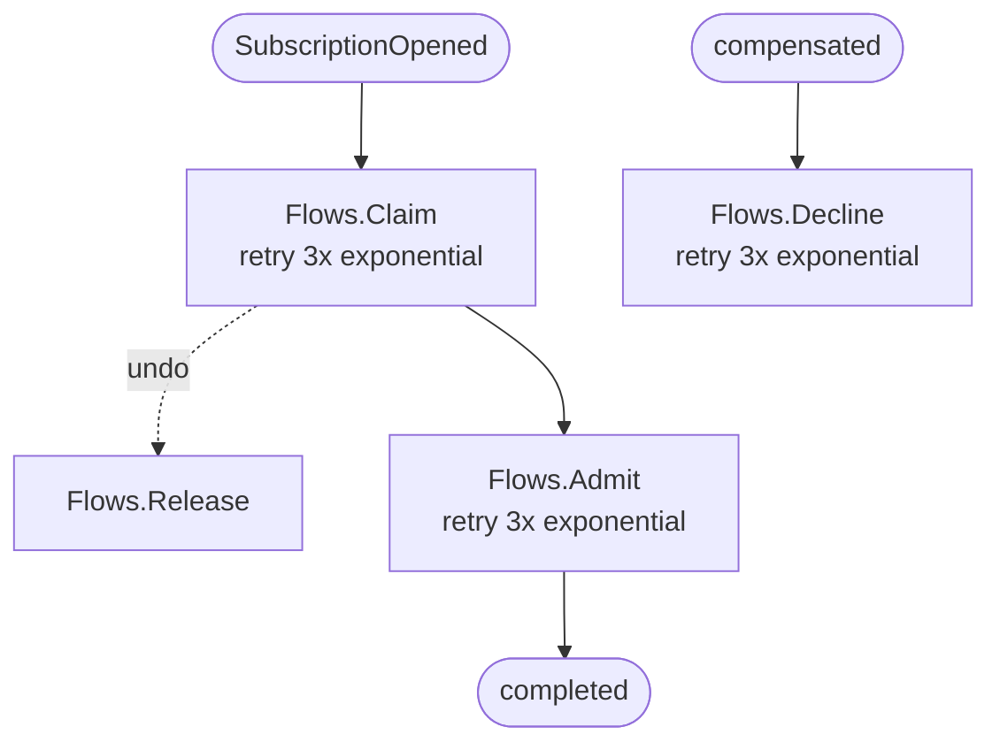
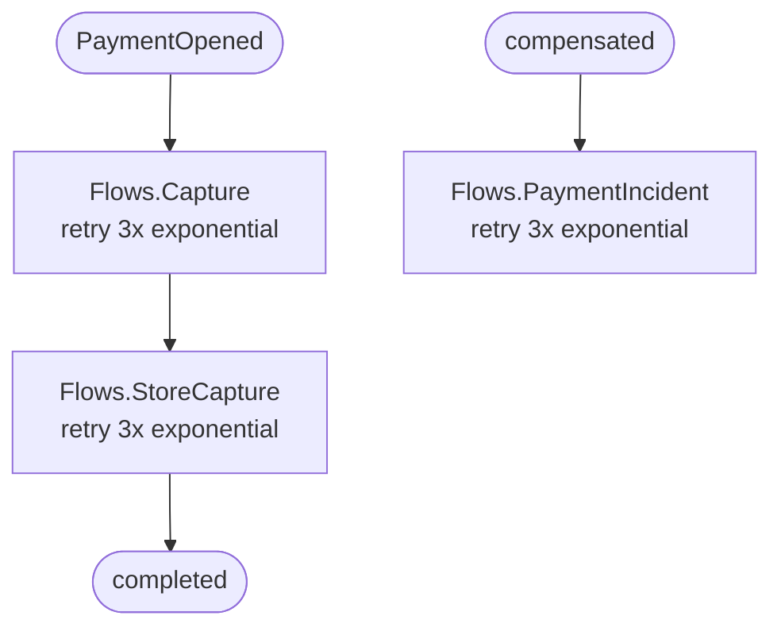
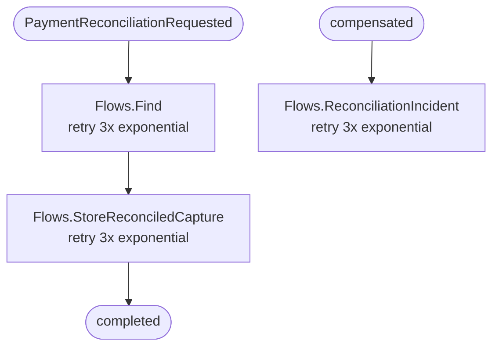
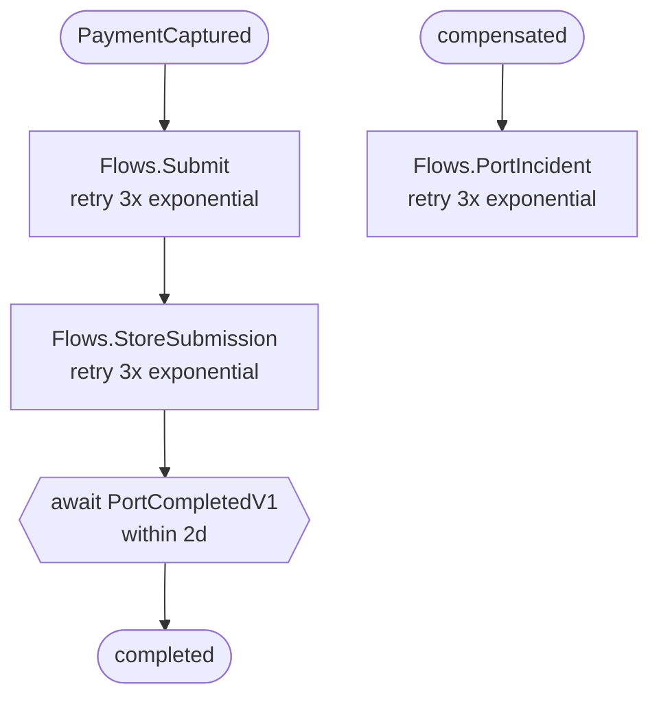
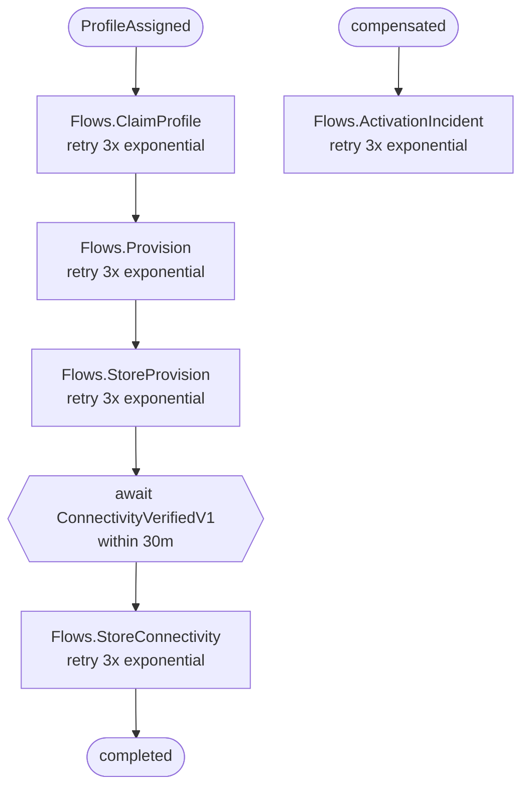
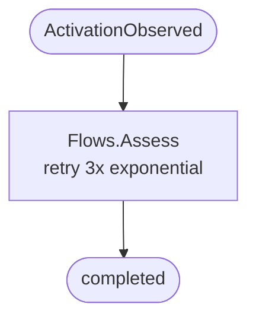
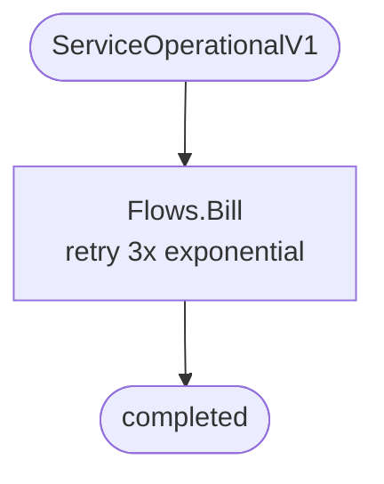

# Process diagrams

Generated by Telecom.Console --diagrams from the actual process definitions.

## Contracting

## PaymentCollection

## PaymentReconciliation

## PortSubmission

## ProfileProvisioning

## ActivationAssessment

## BillingCommencement

