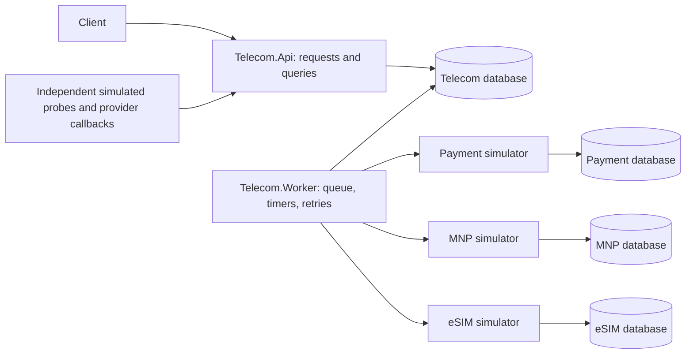
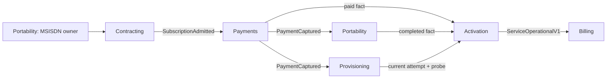
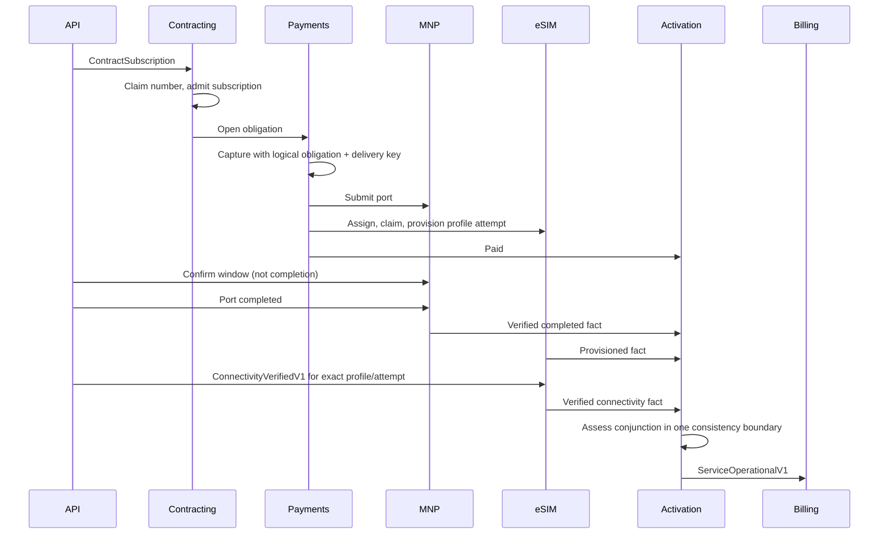

# Telecom: portability, eSIM, payment and service activation

An advanced executable sample for Wyrd 0.5's actual APIs. It models a customer paying a deposit,
porting a number and connecting through an eSIM. Confirmation agrees a porting window; only
completion transfers the number. Provisioning creates a profile; only an independent probe proves
connectivity. Billing starts after all four required facts: paid, port completed, current profile
provisioned, and connectivity verified for that exact profile and attempt.

This is a synthetic telecom protocol, not an implementation of a national MNP specification.
Read [the boundary decisions](ARCHITECTURE.md), [architectural findings](FINDINGS.md) and the
[generated process diagrams](PROCESS-DIAGRAMS.md). The latter come from `Process.ToMermaid()`,
not illustrative APIs.

## Interactive customer and operations workspace

Open `http://localhost:5090` after starting Compose. Contract a line, follow its saved milestones, switch
to Operations, and deliver provider callbacks from the separate local simulator panel. The screen shows
why billing is blocked, domain-owned action rules, incident recovery and actual durable process histories.
Expand the inspector to compare persisted views, BFF composition and rich domain state as facts arrive.
Follow [the guided walkthrough and responsibility map](WORKSPACE.md).

## Find a feature

Everything owned by a business feature lives together: domain rules, application processes, provider
integrations, read models and HTTP presentation. There is one folder per feature, with no command-level
subfolders and no mirrored domain/API/infrastructure projects. For example:

```text
samples/Telecom/
  Features/
    Payments/
      Payment.cs                         state and shared receipt rules
      OpenPayment.cs                     command, decision and opening process
      CapturePayment.cs                  provider integration and collection process
      RecordCapture.cs                   command, event, Decide and Validate
      ReconcilePayment.cs                inquiry decision, process and provider integration
      RecordProviderCapture.cs           callback decision and process
      PaymentBillingStatus.cs            read model
      Contracts.cs                       public payment callback contract
      Endpoints.cs                       MinApiLib HTTP routes and handlers
    Portability/                         number ownership through provider callbacks
    Profiles/                            profile lease, provisioning and connectivity
    Activation/                          verified facts and operational publication
    Subscriptions/                       contracting, admission and customer progress
    Billing/                             operational billing
    Incidents/                           business attention queue
    Operations/                          cross-feature operational queries
    Workspace/                           BFF, UI assets and operator presentation
  Infrastructure/                        shared database, HTTP protocol and DI wiring
  Shared/                                offer, domain errors and HTTP result mapping
  Providers/                             shared simulator protocol and deterministic fake
samples/Telecom.Api/Program.cs            HTTP host bootstrap and endpoint discovery
samples/Telecom.Worker/Program.cs         worker bootstrap and queue processing
```

Start at a feature's `Endpoints.cs`, follow its command to the adjacent decision, then read the process
and provider integration in the same folder. A use-case file keeps its command, decision and process
together when they belong to that operation. Truly shared concerns stay outside features: all provider
integrations use the same HTTP protocol, and all feature state uses the same Wyrd database schema.

HTTP handlers are [MinApiLib.Endpoints](https://github.com/fernandoescolar/MinApiLib/tree/main/src/MinApiLib.Endpoints)
endpoint records with named `HandleAsync` methods. `Telecom.Api` discovers them from the Telecom module
assembly. The module references ASP.NET, MinApiLib and EF Core so all feature layers can live together;
its domain decisions and process step functions remain pure. This is a JIT sample module, not a Native
AOT endpoint example. Wyrd's own Native AOT samples and library remain separate.

Decisions read in order: call `Validate`, return a rejection when present, then produce an event.
Validation methods use explicit guards. Shared receipt rules remain on `Payment`; profile identity and
attempt checks stay next to their operation. Projections use named event handlers where updates need
several facts. Simple event-to-state switches and pure process step functions remain ordinary Wyrd code.

The partial `Flows` class keeps steps next to their workflow while preserving existing process, step
and serialized type identities. Moving files does not change stored message names or the checked-in
Urd incident.

## Run without infrastructure

From the repository root, with the .NET SDK in `global.json`:

```sh
dotnet run --project samples/Telecom.Console
dotnet test samples/Telecom.Tests --filter 'Category!=Containers'
```

The console deliberately loses a successful provisioning response, retries, receives port completion,
misses its connectivity deadline, records and replays the incident, then recovers using a replacement
profile. Its journal is real runtime output. Time is virtual; 31 minutes elapse without waiting.

```sh
# Generate a fresh recording, then replay the saved incident using recorded replies.
dotnet run --project samples/Telecom.Console -- --record /tmp/telecom-incident.json
dotnet run --project samples/Telecom.Console -- --replay /tmp/telecom-incident.json
# Or replay the checked-in recording, generated by the same console.
dotnet run --project samples/Telecom.Console -- --replay samples/Telecom/incidents/connectivity-timeout.history.json
# Regenerate diagrams after changing a process.
dotnet run --project samples/Telecom.Console -- --diagrams samples/Telecom/PROCESS-DIAGRAMS.md
```

`ReplaySpecs` tests the checked-in history, verifies zero provider calls, and deliberately changes a
recorded command to verify divergence detection. Urd tests the process and its step functions against
recorded replies. It does not reconstruct aggregate states, run today's owner decisions, or replay live
payment/MNP/eSIM systems. The history contains synthetic customer data; real histories need access control.

## Run durable API, workers and three independent simulators

```sh
docker compose -f samples/Telecom/compose.yaml up --build -d
python3 samples/Telecom/smoke.py
# Same application, more competing workers:
docker compose -f samples/Telecom/compose.yaml up -d --scale worker=3
# Stop containers; volumes keep sample data.
docker compose -f samples/Telecom/compose.yaml down
```

`Telecom.http` has all requests. The API listens on `http://localhost:5090`; queries are eventually
consistent and can initially return 404. The smoke test allocates synthetic IDs and a number, waits
for provisioning, completes the port, asserts billing has not started, then verifies connectivity and
waits for billing. Providers intentionally return 503 **after** their first capture/provision commit.
Retries retrieve the existing receipt. No credentials, outside services or charges are involved.

For a clean disposable environment, `down --volumes` also deletes these sample databases. The `init`
container and providers use `EnsureCreated` for fresh databases only. Schema upgrades require reviewed
application migrations; these hosts do not pretend `EnsureCreated` performs migrations. Docker builds
use the SDK version required by `global.json`. The EF Core hosts are JIT, not Native AOT.

API and worker share one application database because they are two roles of **one application**.
They are not independent microservices sharing tables. Each outside simulator owns a separate PostgreSQL
server/database and volume. No service reads a provider's tables; only its HTTP interface is used.



The API calls `SendAsync` only for pure domain commands: contract, cancel request, profile assignment
and reconciliation request. It never directly sends an integration command. It queues provider facts
with `PublishAsync` and reads projections. The worker calls `RunAsync`, which executes queued steps,
timers, retries, cleanup and configured transport relays. This sample has no broker transport configured:
its operational integration contract is consumed within the modular application. It does **not** test
a RabbitMQ hop. Wyrd already provides RabbitMQ for a later service split; see the findings for its costs.

To launch hosts outside Docker, set `ConnectionStrings__Telecom`, `Providers__Payments`,
`Providers__Mnp` and `Providers__Esim`, run `Telecom.Worker -- --init`, then start API and worker.
Each `Telecom.Providers` process needs `ProviderKind` (`payments`, `mnp`, `esim`), its own
`ConnectionStrings__Provider`, and an HTTP listening URL. `LoseFirstReply=true` enables deterministic
response loss. The API/operator/webhook endpoints are trusted **local demo** endpoints: public deployment
needs authenticated callers, provider signature validation and authorization of incident operations.

## Six boundaries, not six services



| Boundary | Key and rule | Relevant implementation |
|---|---|---|
| Contracting | Subscription ID, immutable offer; sample admission limit of 250 | `Features/Subscriptions/` |
| Portability | Canonical E.164 number; increasing epoch; one live request even across different subscription IDs | `NumberPort`, `ClaimNumberSlice` |
| Payments | Subscription ID is the single initial obligation; immutable amount and one receipt | `Payment.Capture`, capture/reconciliation processes |
| eSIM inventory | Profile ID; one customer/subscription/attempt lease | `ProfileLease`, `ClaimProfileSlice` |
| Service activation | Subscription ID; independent payment/port facts plus current profile attempt | `Activation`, `ObserveActivationSlice`, `AssessActivationSlice` |
| Billing | Subscription ID; starts once from the trusted operational contract | `BeginBillingSlice`, `OperationalPublication` |

Epochs are caller-supplied positive monotonic revisions per number, not timestamps generated by a decider.
Request identity includes subscription ID and epoch. The number owner checks both on every callback.
Admission seals the reservation in the same MSISDN aggregate before publishing the fact that starts
payment. Even before any provider command executes, that seal prevents an operator compensation from
freeing a number while accepted downstream work is queued. A failed compensation suspends for review.
An active request cannot be displaced by sending a higher epoch. After completion/cancellation, a newer
request can acquire it; delayed earlier commands cannot reacquire it. IDs and phone numbers are validated
before admission. This is resource ownership, not process-key deduplication.

Profile attempts strictly increment and select a different profile. Old leases remain quarantined: a local
undo cannot prove a provisioned eSIM was deactivated externally. A real deactivation and recycling protocol
is outside this sample. Replacement after operational service is deliberately rejected; post-activation
SIM swaps/outage billing policies are different business processes. Per-key states contain bounded facts,
not histories or ever-growing sets of attempts. Keeping one row per real profile/number/obligation is
business storage; it still needs a capacity and lifecycle policy.



## Failures are different business situations

| Situation | Policy |
|---|---|
| Admission rejected after reserving number | `Undo(ReleaseUnsubmittedNumber)`; no provider has been contacted |
| Transport failure / lost response | Technical retry with stable Wyrd message ID; provider also checks logical operation key |
| Provider business rejection | No retry; business incident, with resources retained for explicit review |
| Capture outcome unknown after retries | Suspended payment process; inquiry via `ReconcilePayment` never recharges |
| Confirmed porting window | Record and display dates; no claim that DSL schedules at those dates |
| Port completion missing for two days | Deadline incident; never undo submission/completed portability |
| No verified connectivity within 30 minutes of reaching the wait | Incident, retain profile lease, explicit replacement attempt |
| Port completed but eSIM unavailable | Keep the irreversible completion fact; block billing and recover activation |
| Cancellation requested | Requires recorded submission; keep number ownership until provider cancellation is confirmed; completion may overtake request |
| Connectivity while suspended | Park it; resume consumes it for the same attempt |
| Connectivity after timeout finished the attempt | Old attempt stays finished; replace with a new attempt |

Three outside effects use two identities: `IntegrationContext.IdempotencyKey` (stable message ID on retry)
and a stable **business** operation key (`capture/{subscription}`, `port/{number}/{epoch}`,
`profile/{profile}/{attempt}`). A new message ID or expired inbox must not produce another capture.
The deterministic providers enforce this too. They are an explicitly modeled provider capability,
not a claim that Wyrd creates exactly-once external effects. Real providers without that capability need
inquiry/reconciliation and can leave outcomes unknown.

Reconciliation can establish capture while the original process remains suspended. The API exposes an
explicit resume for that process; reconciliation does not silently rewrite its lifecycle. Domain incidents
are resolved explicitly with `ResolveIncident`; recovery does not automatically close every incident.
Cancellation of an uncertain submission first needs submission reconciliation (not implemented here);
the domain rejects a cancellation request while submission is still unacknowledged, so a delayed first
submission cannot race ahead after an acknowledged cancellation. Provider callbacks remain facts and may
establish actual completion independently. Refund approval/settlement, profile deactivation, downstream invoices, recurrent charging and account
termination are not implemented. Captured money after a cancellation requires operator review, not an
invented automatic refund guarantee.

## Read models and operators

| Query | Projection / meaning |
|---|---|
| `GET /subscriptions/{id}` | `CustomerProgress`: independent paid/port/profile/connectivity facts, derived stage |
| `GET /operations/{id}` | `PortabilityDetail`, `PaymentBillingStatus`, current capture/port/profile process statuses |
| `GET /incidents` | `IncidentItem` business deadline/reconciliation queue; explicit resolve command in the module |
| `GET /health/queue` | Verdandi queue age/depth, suspended count and dead letters |
| `GET /histories/profiles/{id}/{profile}/{attempt}` | Stored Urd history export |

Projection creation events merge into existing facts; they never reset a view produced by a different
stream. Payment and billing facts commute and are idempotent. Profile assignment/provisioning/connectivity
are in the same activation stream, whose original order Wyrd preserves; profile identity and attempt fence
old confirmations. No projection counts external deliveries as business operations. Views can temporarily
show incomplete independent evidence while messages are pending; processes never depend on view freshness.

Suspension does not emit a business domain event, so `/incidents` alone is not a complete list of runtime
suspensions. Combine it with queue health and the per-subscription statuses/history. There is no public
paged suspended-instance query in `IWyrdRuntime`; see the findings. This sample also does not seed projections
added to an existing installation: they are registered before the first command. `ViewsAsync` materializes
all documents; the incidents endpoint is an example query, not a scalable paginated operational console.

## Verification and its limits

```sh
dotnet build
dotnet test samples/Telecom.Tests                 # includes real PostgreSQL; Docker required
dotnet test -c Release --filter 'Category!=Containers'
```

`PureDomainSpecs` checks business rules with Wyrd's Given/When/Then JSON round trips.
`BusinessSpecs` covers duplicates, provider uncertainty, compensation, cancellation, epochs, replacement,
timeouts and recovery. `ProjectionSpecs` enumerates permutations of independent facts, including billing
arriving before payment creation. Same-stream order is a framework guarantee, not randomized away.
`EndpointSpecs` exercises MinApiLib discovery, route/body/service binding and command/query responses
over real HTTP. `HttpProviderSpecs` verifies the actual HTTP casing and idempotency header: the first Compose smoke caught
a casing mismatch that direct fakes could not reveal.

`HostileFuturesSpecs` explores 500 deterministic futures (seeds 27100–27399 and 32000–32199), with transient
command faults, duplicate/reordered delivery, lost provider responses, competing request IDs, cancellation,
replacement and late probes. Shrinking is enabled with a budget of 50 replays per first broken invariant.
Business safety is checked after each external observation point and after settling; Skuld currently offers
only end-of-future invariant hooks, not a public per-commit observer. Suspension is allowed: safety is not
claimed to imply eventual activation. One targeted case checks late events during suspension and resume.

`DurableSpecs` uses real PostgreSQL and separate runtime instances: API/worker separation, two-worker
number contention, interruption after provider commit before reply, lease expiry/restart, and durable timers.
The interruption is a cooperative cancellation at a controlled boundary, **not** an OS crash or database
failover test. Providers remain outside the interrupted host. Compose additionally exercises actual HTTP
and provider-owned databases. None of this proves correctness under arbitrary distributed failures.

Before production sizing, measure hot-number/profile contention, independent-request throughput with several
workers, long provider latency versus lease length, cross-process polling delay, queue/outbox backlogs,
retention cleanup and replay/archive costs. No performance numbers or universal distributed guarantees are
inferred from these small tests. [FINDINGS.md](FINDINGS.md) answers the eight evaluation questions directly.
