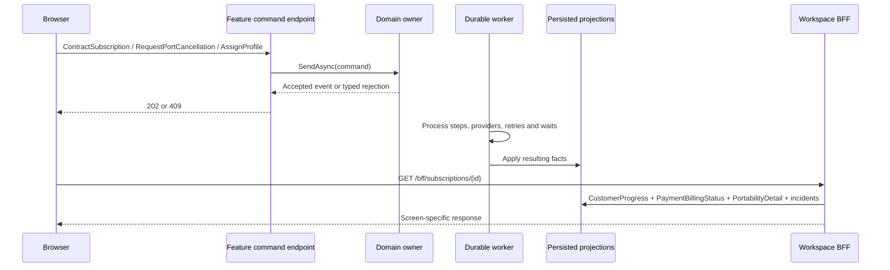

# Telecom workspace: from a business decision to a customer screen

Open `http://localhost:5090` after starting the existing Compose stack. The same API serves a customer
workspace and an operations perspective. No Node build, hosted frontend service or additional database
is required. All HTML, CSS and JavaScript live with their BFF under `Features/Workspace` and are embedded
in the module. MinApiLib discovers the page, allowlisted assets and BFF endpoints.

## A first journey

1. Choose **Contract a line**. The form proposes fresh synthetic subscription/customer/profile identities
   and a canonical phone number. The initial payment is EUR 25. Submit the request.
2. Watch the customer view. Workers claim the resources, capture payment and provision the eSIM. The
   payment and eSIM simulators deliberately lose their first successful replies; retries recover the
   receipts. The browser can be closed while the durable work continues.
3. Switch to **Operations**, expand **Act as the external provider**, and choose **Confirm porting window**.
   A confirmed window is a promise about timing, not a completed transfer.
4. Choose **Complete port**. The number-transfer milestone advances; billing remains off while the
   current eSIM lacks verified connectivity.
5. Choose **Verify connectivity**. It publishes a probe for the displayed profile and attempt. After
   processing, activation becomes operational and billing begins. The domain now rejects both a port
   cancellation and the sample's pre-activation profile replacement.
6. Expand **Views, BFF & rich domain model**. The left panel shows the actual persisted projections;
   the right panel shows diagnostic domain snapshots. The change list compares responses observed by
   this browser; its entries are not a server-side event log.

Every mutation displays acceptance separately from the eventually consistent result. Polling continues
every two seconds. The view selector is a local demonstration perspective, not authentication.

## Explore a problem and recover it

Create another line and leave connectivity unverified. In Operations:

- **Flag connectivity incident** records an operator attention request through `OpenIncident`. It does
  not expire a timer or assert that the process failed. The automatic connectivity timeout still takes
  the declared 30 minutes in the durable runtime.
- Assign a different profile using the next attempt. The same `Activation.CheckProfileAssignment`
  policy is used by the decision and the BFF's advisory availability. Replacement clears provisioning
  and connectivity evidence for the previous profile; its lease remains quarantined.
- In the simulator, send a probe with the old profile and attempt. The current customer's activation
  remains unchanged. Then send a probe for the current profile/attempt and complete the port.
- Resolve the incident explicitly. Resolving attention does not manufacture activation evidence.
- **Reconcile payment** queries the provider for an existing capture without charging again. **Resume
  payment** is available for a suspended capture process; those are distinct operations.
- Before port completion, request cancellation and deliver the provider's cancellation acknowledgement.
  Completion can overtake cancellation; a completed port is irreversible in this sample.

Inspect **Durable processes** for stored Urd entries, actual reply outcomes, retries and waits. The
current profile history can also be exported using the existing history endpoint. Process identities
and the checked-in incident history are unchanged by this UI.

## Responsibilities and data flow

**The rich model** lives in the owning feature, not the browser:

- `NumberPort` owns the MSISDN and epoch. `CheckCancellation` rejects another owner, an unacknowledged
  submission, an already cancelled request or irreversible completion.
- `Activation` owns independent evidence plus the current profile attempt. `CheckProfileAssignment`
  enforces identity, exact next attempt, a different profile and the same customer; operational service
  closes this replacement workflow. `Ready` expresses the activation conjunction.
- `Payment.Capture` owns receipt consistency. Process replies and provider callbacks use the same rule.
- Decisions invoke these policies and emit facts. `Evolve` applies facts. The process describes the
  next steps; external effects remain in integrations.

**The read models** answer different questions: `CustomerProgress` serves the customer journey,
`PortabilityDetail` explains the provider protocol, `PaymentBillingStatus` combines payment and billing,
and `IncidentItem` supports the attention queue. CustomerProgress now includes offer identity and amount
from SubscriptionOpened; pre-existing documents are not retroactively backfilled.

**The BFF** builds a screen-shaped response. The list composes projections without loading every process
history. Detail adds the selected line's process statuses/history and advisory domain policies. The
`Model` property is an explicitly diagnostic read of aggregate snapshots for this educational workspace;
customer business facts come from projections. Each command reloads and validates the authoritative
state, even if an earlier BFF response enabled its button. The stale-action HTTP test demonstrates this.

The BFF is a logical boundary in the same sample module/host. A separately deployed BFF would use the
application's query and command interfaces; this sample does not add a network hop or a shared-database
microservice. Write requests use the existing feature command endpoints; read composition uses `/bff`.

**The frontend** submits requests and renders server responses. It does not advance a workflow, infer
provider success or write business state. Simulator controls explicitly publish demo provider facts.

## Practical limits

Views, domain snapshots and process histories are separate reads, not a transactionally consistent
cross-feature snapshot. Temporary disagreement is expected; command-time rules remain authoritative.
Polling is deliberately simple and there is no push delivery contract. Lists/history are unpaged and
appropriate for a small sample, not a production operations console. Incident lists do not enumerate all
runtime suspensions. Existing retention and the original sample's unimplemented policies still apply.

The customer/operator toggle and trusted local webhook controls need real identity/authorization and
provider verification before a public deployment. The demonstration adds no refunds, SIM recycling,
post-activation swaps, recurring charging or uncertain-port-submission reconciliation.

## Where to read the code

- `Features/Workspace/Workspace.cs`: read composition and advisory actions.
- `Features/Workspace/Endpoints.cs`: the two MinApiLib BFF queries.
- `Features/Workspace/Assets.cs` and `Ui/`: the colocated frontend and allowlisted resource delivery.
- `Features/Portability/NumberPort.cs`: authoritative cancellation policy.
- `Features/Activation/Activation.cs`: authoritative replacement policy and readiness.
- `Features/Incidents/Endpoints.cs`: explicit operator attention actions.
- `Telecom.Tests/WorkspaceSpecs.cs`: HTTP tests for projection evolution, stale-action rejection,
  replacement/old probes, incidents and embedded asset discovery.
